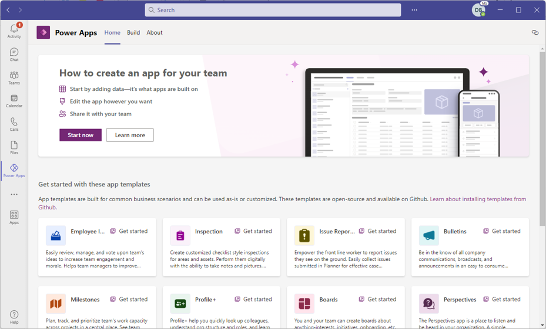
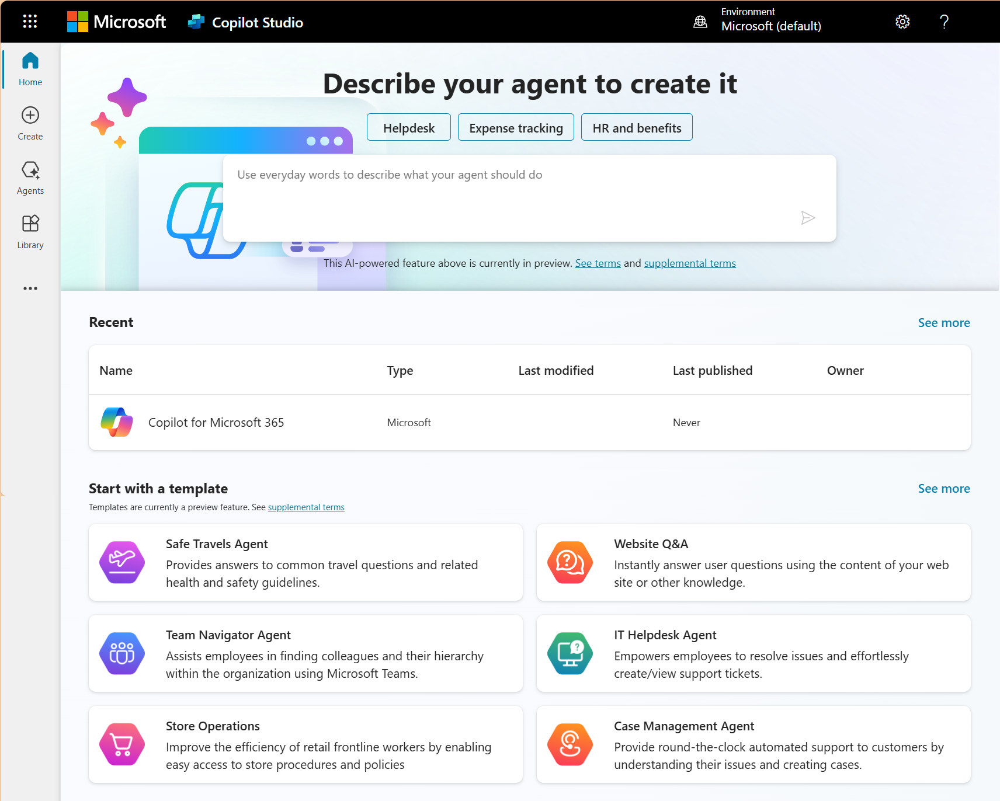
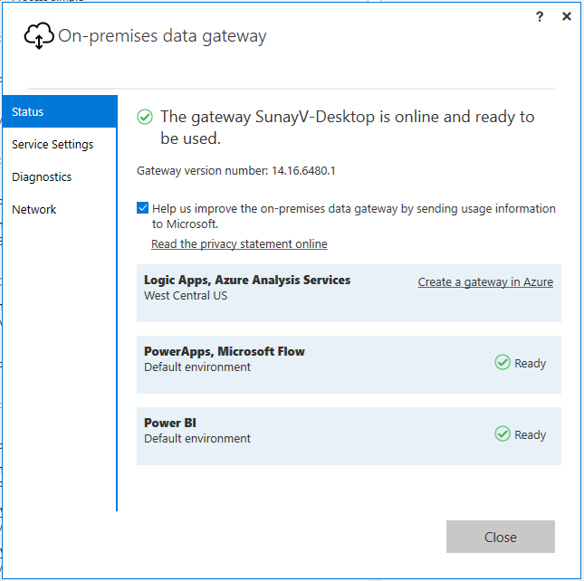
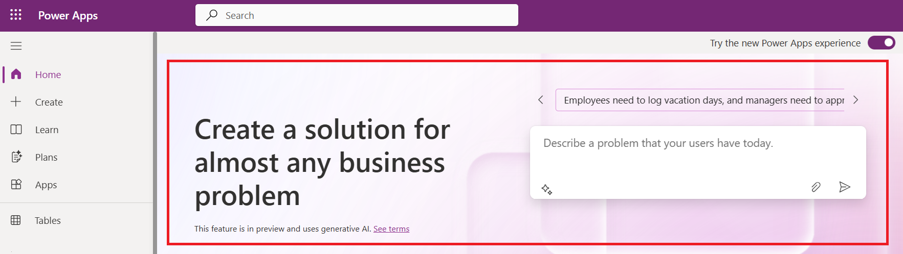

## Introduction

Microsoft Power Platform is a suite of tools designed to enhance productivity, streamline workflows, and simplify the creation of custom solutions without requiring advanced technical skills.

Imagine you're a business owner managing customer inquiries, tracking inventory, and analyzing data while handling daily operations. Or perhaps you're a student working on a project that requires organizing large amounts of information efficiently. In both cases, repetitive tasks and manual processes can quickly become overwhelming. With Microsoft Power Platform, you can automate tasks, create tailored apps, and gain real-time insights, all integrated seamlessly with tools like Microsoft Teams, Excel, and SharePoint. For example, you could set up a workflow to automatically save email attachments to OneDrive or use AI-driven tools to design an app for tracking inventory. Whether you're a business user improving collaboration or an app maker building innovative solutions, this platform helps you solve real-world problems with ease.

### Learning objectives

In this module, you learn:

* How to integrate Microsoft Power Platform with Microsoft 365 and Teams.
* The features of Microsoft Copilot Studio and its functionality.
* Methods to integrate on-premises systems with Microsoft Power Platform.
* The basics of the Plan Designer in Power Apps.

### Describe how Microsoft Power Platform business solutions work together with Microsoft 365 apps and services

Microsoft Power Platform is a suite of tools designed to work seamlessly with Microsoft 365 services, making collaboration and productivity easier. In this learning unit, we explore how apps like Power Apps and Power Automate integrate with Microsoft 365 and Teams to simplify business processes and save time.

#### How Power Platform works with Microsoft 365 apps and services

Many organizations rely on Microsoft technologies for daily operations. Microsoft 365 is often the go-to platform for email, productivity tools, and document management, with services like Outlook, Excel, and SharePoint playing key roles. Because these tools are widely used, the Power Platform offers built-in connectors that allow you to create streamlined solutions by directly interacting with Microsoft 365 services.

Some popular connectors include:

* Office 365 Outlook
* OneDrive
* Excel
* SharePoint

These connectors help administrators, managers, and users work more efficiently. For example, think about how many emails a typical user receives daily. Many of these emails come with attachments that need to be saved in specific locations, like a SharePoint site or a OneDrive folder. Instead of manually saving each attachment, you can use Power Automate to create a flow that automatically detects incoming emails with attachments and saves them to the right folder. If this task takes one to two minutes per email and happens 20 to 30 times a day, automating it could save up to two hours every week. That’s just one example of how Power Platform simplifies tasks.

Another common scenario involves Microsoft Excel, which many organizations still use to manage entire departments. Excel’s formulas, charts, and pivot tables make it a great tool for tracking daily tasks, but getting data into Excel often requires manual effort—copying, pasting, or typing data from other applications. In some industries, users spend five to 10 hours a week entering data into Excel. With Power Automate Desktop flows, you can automate these repetitive tasks by mimicking keystrokes and mouse clicks. What used to take minutes can now be done in seconds, freeing up time for more important work.

The Power Platform doesn’t stop with automating individual tasks. As organizations increasingly adopt collaborative tools like Microsoft Teams, the Power Platform extends its capabilities to this hub for teamwork, enabling greater efficiency and innovation.

#### Using Power Platform components within Microsoft Teams

For the last several years, organizations are rethinking how their workforce gets things done. Many organizations switched to remote work, creating a need for better collaborative tools.

Microsoft Teams fills that need for many organizations. It provides a central point where users can collaborate, have meetings, manage projects, and more. One key advantage of Microsoft Teams is its adaptability. Organizations can build custom applications for Teams based on user needs. Microsoft Power Platform is the gateway to rapidly building Teams-compatible apps using low-code features. All Power Platform components can be used with Microsoft Teams.

Let’s look at how Power Platform components integrate with Teams:

* **Power BI**: The Power BI app in Teams lets users share interactive reports and collaborate directly within Teams channels and chats. You can create custom Power BI apps or templates and distribute them to your team. With the Power BI app, you can bring the full Power BI experience into Teams, making it easier to access analytics without switching platforms.

* **Power Apps**: The Power Apps integration in Teams allows app makers to design, edit, and publish apps directly within the Teams environment. For example, a company could create an incident reporting app that employees can access without leaving Teams. This seamless experience keeps workflows efficient and focused.

* **Power Automate**: With Power Automate, you can build flows to automate repetitive tasks inside Teams. For instance, you can trigger a flow from a Teams message or use Adaptive Cards to interact with flows. These automations enhance the Teams experience.

* **Copilot Studio**: Copilot Studio makes it easy to create and share conversational agents within Teams. These agents can answer questions and assist users with tasks, improving productivity across the organization.

* **Dataverse for Teams**: Dataverse for Teams is a built-in, low-code data platform. It enables users to create custom apps, bots, and workflows directly within Teams using Power Apps, and Power Automate.

Let’s consider a real-world example to see how Power Platform and Teams work together. Many real estate companies shifted to remote work. Their agents now spend most of their time working in Microsoft Teams, collaborating with colleagues, and managing daily activities. By integrating Power Platform with Teams, these companies can provide their agents with tools to work smarter.

Here’s how Power Platform enhances their workflow:

* **Dedicated Copilot agents**: Agents embedded in Teams can answer representatives’ questions and assist with tasks like scheduling open houses or following protocols. This saves time and ensures consistency.
* **Expense Submission App**: Using Dataverse for Teams, companies can create an app for agents to submit travel, staging, and open house expenses—all without leaving Teams.
* **Embedded Power BI Reports**: Analytics about properties can be displayed directly in Teams, giving agents quick access to valuable insights.

For example, imagine an agent in Teams that helps schedule open houses or answer questions about procedures. This kind of automation streamlines their work and keeps everything centralized within Teams.

By combining the capabilities of Microsoft Power Platform with Microsoft 365 and Teams, organizations can unlock new levels of productivity and collaboration. Whether it's automating repetitive tasks, building custom applications, or enhancing teamwork, the possibilities are vast—and you don’t need to be a coding expert to begin.

#### Describe the value of Microsoft Copilot Studio

Microsoft Copilot Studio is a platform that simplifies creating custom AI agents, helping you streamline operations and maximize Microsoft Copilot. Whether you're a business owner, a student, or someone building apps, this tool simplifies workflows and boosts productivity. In this learning unit, we explore what Copilot Studio is, how it works, and how you can use it to solve real-world problems.

Imagine having a smart assistant that handles repetitive tasks, answers questions, and provides solutions tailored to your needs. That's what Microsoft Copilot Studio offers. It allows businesses and individuals to harness AI without needing advanced technical skills.

For businesses, this means saving time and money by automating processes that would otherwise require manual effort. For example, instead of having a team member spend hours responding to customer inquiries, an AI agent can handle those questions instantly. Or, if employees need help with navigating internal systems, an agent can guide them step by step. These tools don't just make work easier—they also help organizations stay competitive in a fast-changing world.

Even if you're not running a business, Copilot Studio can be valuable. Students can use it to organize schedules or get help with assignments, while app makers can create tools that solve specific problems for their users. Copilot Studio lets you design solutions that fit your unique challenges.

#### Key features of Microsoft Copilot Studio

How does Copilot Studio make this possible? It comes packed with features that are both powerful and beginner-friendly. Let's break them down:
* **Simple, low-code interface**: You don't need to be a programmer to use Copilot Studio. The platform lets you describe what you want your AI agent to do in plain language, and it handles the technical details for you. For example, you could say, "I want an agent that helps customers track their orders," and Copilot Studio guides you through building it step by step.

* **Seamless data integration**: Your agent needs information to do its job. Copilot Studio makes it easy to connect your agent to the data it needs. With over 1,400 prebuilt connectors, you can link to Microsoft tools like SharePoint or Excel, and third-party apps like Salesforce or Google Drive. This ensures your agent has access to the right data to provide accurate answers and perform tasks.

* **Automated workflows**: One of the best features is the ability to set up workflows using Power Automate. Think of workflows as instructions for your agent, like, "If a customer asks about a product, send them an email with more details." These workflows allow your agent to respond automatically, saving you time and effort.

* **Multichannel deployment**: Once your agent is ready, you can publish it wherever needed. Whether it's on your website, in a mobile app, on social media, or in Microsoft Teams, your agent can be available to help users wherever they are.

 * **Robust security and governance**: For those concerned about data security, Copilot Studio provides comprehensive protection. It includes tools to manage your agents securely, ensuring they comply with organizational policies and protect sensitive information.

These features work together to make Copilot Studio a powerful yet approachable tool for creating AI agents. You don't need to be an expert. You just need an idea of what you want your agent to do, and Copilot Studio helps you bring it to life.

#### Use cases for Microsoft Copilot Studio agents

Now that you know what Copilot Studio can do, let's talk about how you might use it. The possibilities are endless, but here are some examples:

* **Customer support**: Imagine you run a small business and want to improve customer service. You could create an agent that answers common questions, helps customers track their orders, or guides them through returns. The agent could work on your website, social media, or in a chat app, making it easy for customers to get help anytime.

* **Employee assistance**: If you're part of a larger organization, you could build an agent to assist employees. For example, the agent could help new hires navigate onboarding, answer HR-related questions, or provide training resources. The agent saves time for both employees and HR teams.

* **Sales and marketing**: Sales teams can use agents to quickly access product information, pricing details, or customer insights during meetings. Marketing teams can automate tasks like lead generation or campaign scheduling, freeing up time for creative work.

* **Education and learning**: Students and educators can benefit from agents that answer questions, provide study resources, or help with administrative tasks like scheduling classes or tracking assignments. For example, a student could ask an agent for help with understanding a concept, and the agent could provide a clear explanation or suggest relevant resources.

* **Public services**: Government agencies can use agents for assisting citizens with tasks like applying for permits, checking application statuses, or finding information about local services. These agents make public services more accessible and efficient.

* **Healthcare support**: Healthcare providers can create agents to help patients book appointments, access medical records, or find answers to health-related questions. On the backend, agents can assist with managing workflows, like scheduling staff or tracking inventory.

* **Project management**: Teams working on projects can use agents to stay organized. For example, an agent could track deadlines, assign tasks, and provide updates on progress. By integrating with tools like Microsoft Teams, the agent can keep everyone aligned and informed.

These examples show how flexible Copilot Studio agents can be. Whether you're solving a small problem or tackling a big challenge, you can customize your agent to fit your needs. And because the platform is so user-friendly, you don't need to be an expert to get started.

### Describe how Power Platform works with on-premises solutions

Microsoft Power Platform provides a robust way to integrate with on-premises solutions, enabling seamless data integration and process automation. This capability is essential for organizations that need to connect their cloud-based applications with existing on-premises systems.

#### How Power Platform connects with on-premises systems
Many organizations operate in hybrid environments, where some systems and data are stored locally (on-premises) while others are hosted in the cloud. Microsoft Power Platform bridges this gap using on-premises data gateways, which act as secure connectors between cloud-based tools like Power Apps, Power Automate, and Power BI, and local resources such as databases or file servers. This allows businesses to integrate their local systems with cloud-based solutions, streamlining workflows and enhancing productivity without compromising security.

The gateway is installed as a service on a computer or server within your organization’s network. Once installed, it acts as a bridge that enables cloud tools to securely access on-premises resources. For example, if your company has a database stored on a local server, the gateway allows Power BI to pull data directly from that database to create reports or Power Automate to update records automatically based on new inputs. This eliminates the need for manual data transfers and ensures seamless communication between systems.

Security is a key feature of the gateway. When you set up a connection to an on-premises resource, you provide credentials—such as a username and password—that allow access to the system. The system encrypts these credentials before storing them in the cloud, converting them into a secure code that unauthorized users cannot read. When the gateway accesses the resource, it decrypts the credentials to log in and retrieve the necessary data. This process protects sensitive business information.

Managing the gateway is straightforward. Administrators can assign coadministrators to share responsibility for managing it, ensuring there’s always someone available to handle updates or troubleshoot issues. This capability is especially important in larger organizations, where employee turnover or absences could impact operations. Having multiple administrators ensures continuity and smooth functioning of the gateway.

The on-premises data gateway is valuable for businesses that want to use their existing investments in local systems while taking advantage of modern cloud-based tools. For example, a retail company might use a local database to track inventory but rely on Power BI in the cloud to analyze sales trends across multiple locations. By installing the gateway, companies can ensure that Power BI can securely access the inventory data directly, allowing the team to generate real-time reports without manual intervention. Similarly, workflows created in Power Automate can automatically update the local database whenever new sales data is entered into a cloud-based system, ensuring consistency across platforms.

This integration saves time and improves efficiency and decision-making. Businesses can automate repetitive tasks, reduce errors, and access real-time insights, all while maintaining the security of their local systems. The gateway provides a scalable solution that grows with the organization, supporting expanding workflows and connections as business needs evolve.

In summary, the on-premises data gateway is a powerful tool for businesses operating in hybrid environments. It enables secure, efficient, and seamless integration between local systems and cloud-based tools, helping organizations maximize the value of their existing resources while embracing the benefits of modern technology. Whether it’s automating workflows, analyzing data, or building custom apps, the gateway plays a crucial role in driving business success.

Let’s look at a real-world example. Consider a retail company that tracks inventory using a local database stored on a server at its headquarters. At the same time, the company uses Power BI in the cloud to analyze sales trends across multiple locations. Without the gateway, the team would need to manually export data from the local database and upload it to Power BI. This process is time-consuming and error-prone. By installing the gateway on the server, Power BI can securely access the inventory data directly, allowing the team to generate real-time reports without manual intervention.

Similarly, the company could use Power Automate to create workflows that automatically update the local database whenever new sales data is entered into a cloud-based system, ensuring consistency across platforms.

Some of the key benefits for businesses include:

* **Seamless** integration: The gateway connects cloud tools to on-premises systems, enabling hybrid workflows without disrupting existing processes.
* **Improved efficiency**: Automating repetitive tasks and enabling real-time data access reduces manual effort and speeds up operations.
* **Enhanced** security: With encrypted credentials and secure communication, businesses can confidently integrate their systems without compromising sensitive data.
* **Scalability**: As businesses grow, the gateway supports expanding workflows and connections, making it a future-proof solution.

#### Describe the capabilities of the Plan Designer

This unit introduces the Plan Designer in Power Apps, a conversational AI-powered tool that simplifies creating tailored business solutions. By using natural language inputs and intuitive design, the Plan Designer helps users turn their ideas into impactful apps, workflows, and data models with ease.

###### The Plan Designer in Power Apps: simplifying business solutions
The Plan Designer in Power Apps makes creating business solutions easy and accessible, even for beginners. It uses Artificial Intelligence (AI) to transform business needs into complete, ready-to-use solutions. Whether you’re managing inventory, tracking sales, or automating tasks, the Plan Designer builds tools that save time and improve efficiency. It also streamlines operations without requiring advanced technical skills.

###### How does the Plan Designer work?
Using the Plan Designer is simple and intuitive. Start by describing your business problem in plain language, such as "I need an app to track customer orders" or “I want to automate reminders for overdue invoices.” You can also provide images, like process diagrams or screenshots of older systems, to give more context. Based on this input, the Plan Designer generates a tailored solution using Power Platform tools like Dataverse tables, apps, and workflows.

For example, the Plan Designer identifies who uses the solution—such as employees, managers, or customers—and what they need to do. It might create roles like “Salesperson” with tasks such as entering orders and checking inventory. It also builds data models, setting up tables to store information like customer details, sales records, or inventory levels. These tables are visually organized in an Entity Relationship Diagram (ERD), which shows how all the data connects.

The tool designs user experiences, suggesting apps and workflows based on your needs. For instance, it might create a simple app for employees to enter sales data or a workflow that sends reminders for overdue invoices. If the initial solution isn’t right, you can provide feedback to refine it. For example, you might ask for more columns in a table or changes to the app layout, and the Plan Designer updates the solution accordingly. This iterative process ensures the final product meets your specific business needs.

###### How the Plan Designer simplifies solution creation through conversation

The Plan Designer is ideal for people without technical expertise. Instead of writing complex code or spending hours designing apps from scratch, you simply describe your problem in everyday language, and the tool does the rest. It’s like having a virtual assistant that understands your business challenges and builds solutions for you.

Imagine you run a small retail business and want to keep track of customer orders and inventory. You can tell the Plan Designer, "I need an app to track customer orders and notify me when inventory is running low." You upload a screenshot of your current order tracking spreadsheet to show how you’ve been managing things so far. The Plan Designer then creates:
* A table to store customer orders, including columns for order date, product name, quantity, and status.
* A simple app for employees to enter new orders and check inventory levels.
* A workflow that sends notifications when inventory drops below a certain threshold.

If you wanted to add a column to track delivery dates, the Plan Designer updates the solution to include that feature.

Here’s a visual example to illustrate how easy it's to get started:

This image shows how you can type in your business problem, and the Plan Designer begins creating a solution tailored to your needs.

##### Key benefits for businesses
The Plan Designer offers several benefits for businesses looking to streamline operations and improve productivity:

* **Simplicity**: You don’t need to be a technical expert to use the Plan Designer. It’s user-friendly and intuitive.
* **Efficiency**: By automating the creation of apps, workflows, and data models, the Plan Designer saves time and reduces manual effort.
* **Customization**: The tool lets you refine and adjust solutions to fit your specific business needs.
* **Scalability**: Whether you’re solving a small problem or building a solution for a larger team, the Plan Designer scales to meet your requirements.

By automating repetitive tasks, improving workflows, and enabling real-time insights, the Plan Designer helps businesses focus on growing their operations and serving their customers.