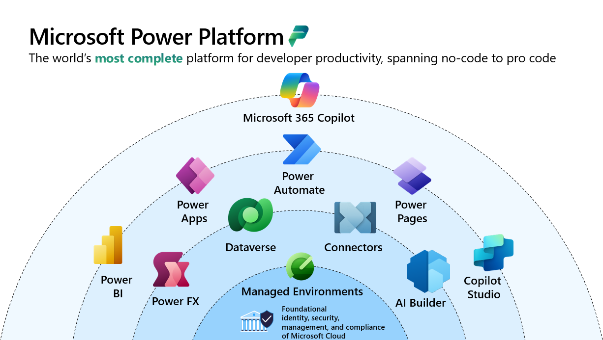
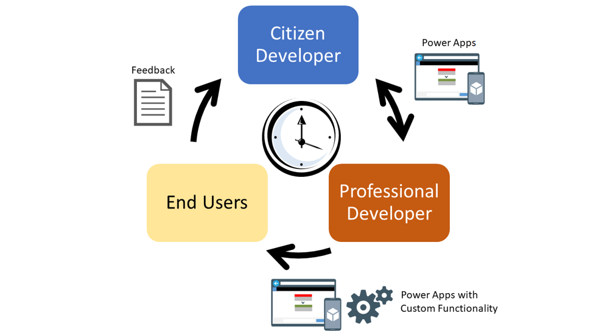

# Introduction
Microsoft Power Platform offers a suite of low-code tools that empower organizations to build custom solutions quickly and efficiently. This module explores the business value of these services and their impact on modern enterprises.

Modern businesses run on data. Daily, users are performing tasks such as entering their time for payroll, working through existing processes, or using data to make business related decisions. In our technology-driven world, users can be empowered to gain insights from and interact with data all while automating menial or repetitive job tasks. Microsoft Power Platform enables your business to craft solutions while empowering you to unite customized technology to help everyone and to drive the business with data-driven insights.

This module focuses on Power Platform, a comprehensive suite of products. Power Platform enables users to build custom applications, create data visualizations, automate workflows, and manage business processes with ease. By the end of this module, you have a clear understanding of what Power Platform is and why it's valuable for businesses.

You explore the individual components of the platform, including Power BI, Power Apps, Power Automate, Power Pages, and Microsoft Dataverse, and learn how they work together to deliver integrated solutions. The module also introduces connectors, which allow seamless integration with various data sources. It explains the importance of Dataverse as a scalable and secure data platform for building business solutions.

Also, you learn about Power Fx, the low-code programming language used within Power Platform, designed to simplify app development and customization. The module highlights Copilot, an AI-powered assistant in Power Platform, which enables users to perform tasks by providing instructions in natural language. You gain insights into how to craft effective prompts to maximize Copilot’s capabilities.

**Learning objectives**
In this module, you learn how to:

* Describe the business value of Power Platform.
* Describe connectors in Power Platform.
* Describe using Microsoft Dataverse to organize business data.
* Describe the value of Power Fx.
* Describe Power Platform.
* Describe how Power Platform services work together.
* Describe the value of Copilots and generative AI features in Power Platform.
* Describe how to write effective prompts for Power Platform.

## Explore Microsoft Power Plataform
Microsoft Power Platform provides organizations with tools to empower their team members to build their own solutions using an intuitive low-code or no-code set of services. These services simplify the process of creating solutions. With Power Platform, solutions can be built in days or weeks instead of months or years. Microsoft Power Platform includes four key products: Power Apps, Power Automate, Power BI, and Power Pages.

### Microsoft Power Apps
Power Apps provides a rapid low-code development environment for building custom apps to meet business needs. It includes a suite of app development services, a scalable data platform (Microsoft Dataverse), and the ability to interact with cloud and on-premises data sources. Power Apps enables the creation of web and mobile applications that run on all devices.

People use mobile apps in every area of their lives, and business should be no exception. Most out-of-the-box solutions don't meet exact business needs or integrate well with other business programs. Power Apps simplifies app development with a user-friendly interface, so every business user or professional developer can build custom apps.

### Microsoft Power Automate
Power Automate allows users to create automated workflows between applications and services. It automates repetitive business processes such as communication, data collection, and decision approvals. Don't waste productive hours drafting the same email for a weekly update or manually managing approval processes. Power Automate provides automation for individual users and enterprise-grade processes. Its simple interface enables users of all technical skill levels to automate work tasks.

### Microsoft Power BI
Power BI is a business analytics service that delivers insights for analyzing data. It shares those insights through data visualizations, which make up reports and dashboards to enable fast, informed decisions. Power BI scales across an organization and includes built-in governance and security, allowing businesses to focus on using data rather than managing it.

Power BI serves as the analysis and insights component of Power Platform. A Power BI dashboard can replace standing meetings by reporting on company metrics such as sales data, progress against goals, or employee performance.

### Microsoft Power Pages
Microsoft Power Pages is a secure, enterprise-grade, low-code software-as-a-service (SaaS) platform for creating, hosting, and managing modern external-facing business websites. Whether you're a low-code maker or a professional developer, Power Pages enables you to quickly design, configure, and publish websites. These websites work seamlessly across web browsers and devices. Power Pages offers rich customizable templates, a fluid visual experience through a reimagined design studio, and an integrated learning hub to help you build sites that meet your unique business needs.

With Power Pages, you can build sites using the same shared business data stored in Microsoft Dataverse. This is the same data used for building apps, workflows, intelligent virtual agents, reports, and analytics with other Power Platform components in your organization.

### Supporting tools
In addition to the products listed, other tools enhance the solutions you create on Power Platform. These include:

#### Microsoft Copilot Studio
Microsoft Copilot Studio is a low-code tool that combines powerful conversational capabilities from custom Generative Pretrained Transformers (GPTs), generative AI plugins, and manual topics. These features can customize Microsoft Copilot and build standalone agents.

#### Connectors
Connectors link apps, data, and devices in the cloud. Think of connectors as bridges for information and commands. Connectors are used by Power Apps, Power Automate flows, and logic apps. There are more than 1,400 prebuilt connectors for Power Platform, enabling seamless integration of data and actions. Popular connectors include Salesforce, Office 365, Twitter, Dropbox, Google services, and more.

#### AI Builder
AI Builder allows users and developers to add AI capabilities to workflows and Power Apps. It's a turnkey solution that makes it easy to add intelligence to workflows or apps and predict outcomes to improve business performance without writing code.

#### Microsoft Dataverse
Dataverse is a scalable data service and app platform that lets users securely store and manage data from multiple sources. It integrates data into business applications using a common data model, ensuring ease and consistency. Microsoft Dataverse is the foundation that enables Power Platform components to work together. It consolidates, displays, and manipulates data.

#### Power Fx
Power Fx is the low-code programming language used across Power Platform. It is easy to learn and use, and it uses Excel-like formulas to create applications.

#### **Managed Environments**
Managed environments are secure, isolated environments within Power Platform. They allow organizations to build, test, and deploy applications while maintaining control over data and resources.

### Describe the value of Microsoft Power Platform

This unit explores how Microsoft Power Platform addresses modern business challenges by enabling organizations to streamline operations and empower users with low-code tools. It also demonstrates how the platform delivers scalable, efficient solutions tailored to evolving needs.

#### Addressing modern business challenges with Power Platform
Many organizations face significant challenges in building solutions that empower their users and meet evolving business demands. Modernizing legacy systems is often a daunting task, compounded by resource constraints and the increasing need for targeted applications. With application demand outpacing delivery capacity—often by as much as five times—departments struggle to keep up, especially amidst labor shortages and rapidly changing business requirements.

Beyond resource limitations, enterprises today are navigating other complexities:

* **Evolving workforce expectations**: Millennials and Gen Z now represent most of the workforce. They grew up in a world of tailored experiences and collaboration through social media. Given the rapid rise of AI, organizations need to adapt to fit this new reality. To best apply their abilities, organizations must deliver more custom, streamlined, and collaborative digital experiences.

* **Rising costs of custom application development**: Developing custom applications is time-intensive and expensive. Beyond initial development costs, organizations must account for ongoing maintenance, which can strain budgets and resources.

* **Demand for agility**: Traditional development cycles, which can take months to deploy solutions and weeks to implement minor changes, no longer align with the fast-paced nature of modern business. Organizations need the ability to quickly build and adapt solutions to meet shifting strategies and needs.

* **Scaling development efficiently**: To address growing demands, organizations must rethink their approach to solution development. By enabling citizen developers (power users) to participate in the development process, businesses can create hybrid teams that combine the expertise of professional developers with the insights of end-users, fostering scalable and efficient development practices.

#### The Power Platform solution
Power Platform addresses critical business challenges by offering a suite of low-code tools that enable organizations to modernize their systems, optimize operations, and empower employees. The platform encourages collaboration between citizen developers and professional developers, creating a fusion development environment where both groups leverage their unique strengths to build targeted, scalable solutions.

For example, consider a scenario involving field technicians at The Phone Company. These technicians often face delays when requesting replacement parts for network repairs or equipment maintenance. Traditionally, they would submit a request and wait for inventory personnel to respond, only to find out later that the required part was unavailable. This inefficiency disrupts workflows, delays service delivery, and reduces overall productivity.

Using Power Apps, technicians can create a dedicated app to check inventory levels in real time while onsite. The app enables them to request parts directly, eliminating unnecessary back-and-forth communication and delays. Using their firsthand knowledge of field operations, technicians can design an intuitive user interface tailored to their specific needs. Once the prototype is ready, professional developers can step in to enhance the app by integrating APIs for real-time inventory updates and connecting it to The Phone Company’s backend systems using Power Automate. This collaborative approach, known as fusion development, ensures the app is both user-friendly and technically robust, addressing the technicians' immediate needs while adhering to enterprise-grade standards.

### An example: The Phone Company
The Phone Company, a leading telecom provider, shows how the Power Platform can transform operations and improve customer service. By using Power BI, Power Apps, Power Automate, and Power Pages, the company gained efficiency, streamlined workflows, and enhanced its ability to serve customers in a competitive market.

#### Power BI: Data-driven decision making
The Phone Company struggled with scattered data from customer accounts, network performance, sales, and support interactions. This made it hard to gain actionable insights. Power BI brought all this data together into interactive dashboards and real-time reports. These tools gave management a clear view of key metrics like customer churn rates, network uptime, sales trends, and call center performance. With this information, the company made smarter decisions, allocated resources more effectively, and addressed issues like network outages or declining customer satisfaction. This approach improved efficiency and helped the company stay competitive.

#### Power Apps: Empowering field technicians
Field technicians faced challenges with outdated processes for managing service calls, reporting network issues, and tracking repairs. Power Apps enabled the creation of a custom mobile app for technicians. The app allowed them to log service activities, capture photos of damaged equipment, and update repair statuses in real time. It integrated with the CRM and network management systems, ensuring all stakeholders had up-to-date information. This eliminated paper forms, reduced errors, and sped up service restoration. Technicians became more productive, and customers experienced faster resolutions, improving satisfaction.

#### Power Automate: Streamlining workflows
Manual workflows caused delays in customer onboarding, billing, and service ticket management. Power Automate replaced these repetitive tasks with automation. For example, when a new customer signed up for a plan, the system updated the CRM, provisioned services, sent a welcome email, and scheduled a follow-up call. Billing processes were also automated to ensure timely invoice generation and payment reminders. These automations reduced processing times, minimized errors, and freed employees to focus on strategic tasks like improving customer retention and launching new services.

#### Power Pages: Enhancing customer support
Long wait times and overloaded call centers created frustration for customers. The Phone Company introduced a self-service portal using Power Pages. The portal, available 24/7, allowed customers to manage accounts, troubleshoot common issues (like resetting routers or checking for outages), and access FAQs about plans and services. Customers could also track service requests and chat with a virtual assistant for quick help. This reduced the volume of support calls, improved response times, and empowered customers to resolve issues on their own. The result was a better customer experience, stronger loyalty, and lower support costs.

#### Driving transformation with Power Platform
The Phone Company used the Power Platform to transform its operations across multiple areas. Teams made smarter, data-driven decisions, automated repetitive workflows, and delivered better service to customers. These changes positioned the company as a leader in the telecom industry. They scaled operations efficiently while maintaining high levels of customer satisfaction.

This example shows how businesses can use the Power Platform to solve real-world problems, modernize systems, and achieve meaningful results. With low-code tools, seamless integration, and flexible development options, the Power Platform helps businesses adapt to change, innovate, and deliver value to employees and customers alike.

### Describe the value of connectors in integrating services and data

Connectors in Microsoft Power Platform are tools that help different apps and services, like Power Apps, Power Automate, Power BI, Power Pages, and Microsoft Dataverse, work together. They make it easy to share data and connect systems, improving how these tools function and making them more efficient.

#### The role and value of connectors
Connectors act as bridges that link different services and data sources within the Power Platform. They simplify how apps and workflows interact with data, making it easier to manage and automate tasks. With over 1,400 prebuilt connectors available, they provide ready-to-use actions for various services, saving time and effort.

Let’s look at an example: A building management company hires vendors for tasks like cleaning and landscaping after tenants move out. Vendors send invoices to the company, and the company wants to automate how these invoices are processed. Here’s what the current process looks like:

* Receiving invoices as email attachments through Microsoft Exchange.
* Saving the attachments in Microsoft SharePoint.
* Sending the invoices to managers for approval via Microsoft Teams.
* Adding approved invoices to the company’s Oracle Enterprise Resource Management (ERP) system.
* Sending confirmation emails with invoice numbers back to vendors.

This workflow involves multiple services, each requiring different accounts, and actions. Here’s how the services work together:

* Microsoft 365 Outlook: Watches a mailbox for incoming invoices.
* Microsoft SharePoint: Saves invoice attachments in a specific folder.
* Microsoft Teams: Sends approval requests to managers.
* Oracle: Adds approved invoices to the ERP system and stores details for future use.
* Microsoft 365 Outlook: Sends confirmation emails to vendors.

Power Platform connectors make it easy to link these services. They act as middlemen, helping the app or workflow interact with the data sources without needing complicated setups.

#### How connectors work
Connectors come with prebuilt actions that make working with data sources simple. For example, the Microsoft 365 Outlook connector includes actions like downloading attachments, sending emails, and managing calendar events. You just need to fill in a few basic details, and the connector handles the rest.

Here’s how connectors are used across the Power Platform:

* **Power Apps**: Connectors link apps to data sources. For example, a company might create an order fulfillment app for employees in the field. Connectors would link the app to data sources like an SQL database or Microsoft Dataverse.
* **Power Automate**: Connectors help workflows connect to data sources, either as triggers (starting a process) or actions (performing a task).
* **Power Pages**: Connectors allow web pages to show live data, like customer account info or support ticket updates. This capability enables interactive experiences for users.
* **Power BI**: Connectors let Power BI pull data from various sources, like ERP systems or cloud databases, to create dashboards and reports. This combined data pool allows businesses to analyze data and make smarter decisions.

By using connectors, developers can easily link and automate processes across different services. Apps and workflows in the Power Platform are therefore more powerful and efficient.

### Describe the value of Microsoft Dataverse in organizing business data

This unit examines Microsoft Dataverse, a versatile data platform that helps organizations securely store and manage business data. It integrates seamlessly with various components of the Power Platform, enhancing data management and application development.

#### Microsoft Dataverse overview
Microsoft Dataverse is a cloud-based data platform designed to securely store, manage, and organize structured business data. As a core component of the Microsoft Power Platform, Dataverse provides a robust and scalable foundation for application development, workflow automation, and data integration. Dataverse uses a relational database model to organize data into tables made up of rows and columns. Each column is assigned a specific data type, such as text, integers, or dates. The platform includes a suite of standard tables for common business scenarios while also supporting the creation of custom tables to address unique organizational requirements.

Dataverse centralizes data and metadata management in the cloud, eliminating the need for on-premises infrastructure and reducing the complexity associated with managing storage systems. Preconfigured standard tables, such as those for accounts, contacts, and activities, provide a ready-made framework for typical business use cases, enabling rapid deployment. For more specialized needs, custom tables can be created to capture and organize data specific to an organization’s processes.

Security is a cornerstone of Dataverse, offering role-based access control (RBAC) to ensure sensitive information is accessible only to authorized users. Other security features include field-level security and auditing capabilities, which enhance data protection and compliance with regulatory standards. These measures make Dataverse a reliable choice for organizations requiring stringent data governance.

Dataverse works smoothly with Microsoft services like Azure, Dynamics 365, and Microsoft 365, as well as third-party platforms such as Salesforce and SAP Enterprise Resource Management (ERP). This interoperability enables organizations to synchronize, transform, and import/export data across systems efficiently.

* **Scheduled data synchronization**: Automate regular updates between Dataverse and external systems, such as synchronizing customer interaction data from a CRM.
* **Data transformation**: Use Power Query to clean, format, and prepare imported data before storing it in Dataverse, ensuring consistency and accuracy.
* **One-time imports**: Simplify the process of uploading data from external sources, such as Excel files, without requiring advanced technical expertise.

Here are some of the key benefits Dataverse offers:

* **Centralized data management**: Consolidates data and metadata in the cloud, reducing fragmentation and simplifying administration.
* **Scalability**: Supports large-scale data operations, making it suitable for organizations of all sizes.
* **Robust security**: Implements role-based access control, field-level encryption, and auditing to protect sensitive data.
* **Integration**: Facilitates seamless connectivity with Microsoft services and third-party platforms, streamlining workflows and data sharing.
* **Flexibility**: Provides the tools and infrastructure to support a wide range of use cases, from app development to advanced data analysis.

#### Role in the Power Platform ecosystem

Dataverse serves as the backbone for various components of the Power Platform, enabling seamless data management and integration across tools.

* **Power Apps**: Dataverse provides a secure and scalable backend for Power Apps, supporting application development across desktop, web, mobile, and Microsoft Teams. For example, developers can create a mobile app for field agents to access property details, update listings, and log client interactions in real time. Dataverse’s offline functionality ensures data accessibility even in areas with limited connectivity, with automatic synchronization upon reconnection

* **Power Automate**: Dataverse enhances Power Automate by offering connectors to hundreds of services, enabling the automation of repetitive tasks and optimization of workflows. For instance, a workflow can be implemented to send automated follow-up emails post-purchase, eliminating manual intervention. Validation rules can also be enforced on employee records to ensure data integrity, such as verifying salary entries against predefined ranges.

* **Power BI**: Dataverse integrates seamlessly with Power BI to support data visualization and analytics. Users can create interactive dashboards and reports, taking advantage of advanced analytics through integration with a managed data lake. For example, a dashboard can be designed to monitor monthly sales performance across regions, with drill-down capabilities for detailed insights. Machine learning models can also be applied to predict customer behavior and identify patterns.

* **Power Pages**: Dataverse extends its capabilities to Power Pages, enabling organizations to build dynamic, data-driven web portals. These portals can be customized to meet specific needs while maintaining the security and scalability of the underlying data platform. For example, a customer portal can let users view their account details, submit support tickets, and track orders. Dataverse ensures the data is accessed securely and efficiently.

[View this video for a comprehensive overview of Dataverse.](https://www.youtube.com/watch?v=47YS2liNf6E&list=PPSV)

Dataverse is a powerful data platform that supports the Power Platform. It provides a secure, scalable, and flexible foundation for managing, connecting, and using business data. Its deep integration with Microsoft services and third-party platforms makes it an indispensable tool for organizations seeking to optimize their data operations and drive innovation. Whether developing applications, automating workflows, visualizing data, or building web portals, Dataverse provides the technical infrastructure necessary to support these initiatives effectively. By centralizing data management and simplifying its administration, Dataverse empowers businesses to focus on solving challenges, foster innovation, and achieve their strategic goals.