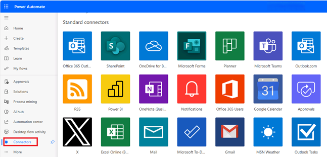

# Introduction
Microsoft Power Platform offers a suite of low-code tools that empower organizations to build custom solutions quickly and efficiently. This module explores the business value of these services and their impact on modern enterprises.

Modern businesses run on data. Daily, users are performing tasks such as entering their time for payroll, working through existing processes, or using data to make business related decisions. In our technology-driven world, users can be empowered to gain insights from and interact with data all while automating menial or repetitive job tasks. Microsoft Power Platform enables your business to craft solutions while empowering you to unite customized technology to help everyone and to drive the business with data-driven insights.

This module focuses on Power Platform, a comprehensive suite of products. Power Platform enables users to build custom applications, create data visualizations, automate workflows, and manage business processes with ease. By the end of this module, you have a clear understanding of what Power Platform is and why it's valuable for businesses.

You explore the individual components of the platform, including Power BI, Power Apps, Power Automate, Power Pages, and Microsoft Dataverse, and learn how they work together to deliver integrated solutions. The module also introduces connectors, which allow seamless integration with various data sources. It explains the importance of Dataverse as a scalable and secure data platform for building business solutions.

Also, you learn about Power Fx, the low-code programming language used within Power Platform, designed to simplify app development and customization. The module highlights Copilot, an AI-powered assistant in Power Platform, which enables users to perform tasks by providing instructions in natural language. You gain insights into how to craft effective prompts to maximize Copilot’s capabilities.

**Learning objectives**
In this module, you learn how to:

* Describe the business value of Power Platform.
* Describe connectors in Power Platform.
* Describe using Microsoft Dataverse to organize business data.
* Describe the value of Power Fx.
* Describe Power Platform.
* Describe how Power Platform services work together.
* Describe the value of Copilots and generative AI features in Power Platform.
* Describe how to write effective prompts for Power Platform.

## Explore Microsoft Power Plataform
Microsoft Power Platform provides organizations with tools to empower their team members to build their own solutions using an intuitive low-code or no-code set of services. These services simplify the process of creating solutions. With Power Platform, solutions can be built in days or weeks instead of months or years. Microsoft Power Platform includes four key products: Power Apps, Power Automate, Power BI, and Power Pages.

### Microsoft Power Apps
Power Apps provides a rapid low-code development environment for building custom apps to meet business needs. It includes a suite of app development services, a scalable data platform (Microsoft Dataverse), and the ability to interact with cloud and on-premises data sources. Power Apps enables the creation of web and mobile applications that run on all devices.

People use mobile apps in every area of their lives, and business should be no exception. Most out-of-the-box solutions don't meet exact business needs or integrate well with other business programs. Power Apps simplifies app development with a user-friendly interface, so every business user or professional developer can build custom apps.

### Microsoft Power Automate
Power Automate allows users to create automated workflows between applications and services. It automates repetitive business processes such as communication, data collection, and decision approvals. Don't waste productive hours drafting the same email for a weekly update or manually managing approval processes. Power Automate provides automation for individual users and enterprise-grade processes. Its simple interface enables users of all technical skill levels to automate work tasks.

### Microsoft Power BI
Power BI is a business analytics service that delivers insights for analyzing data. It shares those insights through data visualizations, which make up reports and dashboards to enable fast, informed decisions. Power BI scales across an organization and includes built-in governance and security, allowing businesses to focus on using data rather than managing it.

Power BI serves as the analysis and insights component of Power Platform. A Power BI dashboard can replace standing meetings by reporting on company metrics such as sales data, progress against goals, or employee performance.

### Microsoft Power Pages
Microsoft Power Pages is a secure, enterprise-grade, low-code software-as-a-service (SaaS) platform for creating, hosting, and managing modern external-facing business websites. Whether you're a low-code maker or a professional developer, Power Pages enables you to quickly design, configure, and publish websites. These websites work seamlessly across web browsers and devices. Power Pages offers rich customizable templates, a fluid visual experience through a reimagined design studio, and an integrated learning hub to help you build sites that meet your unique business needs.

With Power Pages, you can build sites using the same shared business data stored in Microsoft Dataverse. This is the same data used for building apps, workflows, intelligent virtual agents, reports, and analytics with other Power Platform components in your organization.

### Supporting tools
In addition to the products listed, other tools enhance the solutions you create on Power Platform. These include:

#### Microsoft Copilot Studio
Microsoft Copilot Studio is a low-code tool that combines powerful conversational capabilities from custom Generative Pretrained Transformers (GPTs), generative AI plugins, and manual topics. These features can customize Microsoft Copilot and build standalone agents.

#### Connectors
Connectors link apps, data, and devices in the cloud. Think of connectors as bridges for information and commands. Connectors are used by Power Apps, Power Automate flows, and logic apps. There are more than 1,400 prebuilt connectors for Power Platform, enabling seamless integration of data and actions. Popular connectors include Salesforce, Office 365, Twitter, Dropbox, Google services, and more.

#### AI Builder
AI Builder allows users and developers to add AI capabilities to workflows and Power Apps. It's a turnkey solution that makes it easy to add intelligence to workflows or apps and predict outcomes to improve business performance without writing code.

#### Microsoft Dataverse
Dataverse is a scalable data service and app platform that lets users securely store and manage data from multiple sources. It integrates data into business applications using a common data model, ensuring ease and consistency. Microsoft Dataverse is the foundation that enables Power Platform components to work together. It consolidates, displays, and manipulates data.

#### Power Fx
Power Fx is the low-code programming language used across Power Platform. It is easy to learn and use, and it uses Excel-like formulas to create applications.

#### **Managed Environments**
Managed environments are secure, isolated environments within Power Platform. They allow organizations to build, test, and deploy applications while maintaining control over data and resources.

### Describe the value of Microsoft Power Platform

This unit explores how Microsoft Power Platform addresses modern business challenges by enabling organizations to streamline operations and empower users with low-code tools. It also demonstrates how the platform delivers scalable, efficient solutions tailored to evolving needs.

#### Addressing modern business challenges with Power Platform
Many organizations face significant challenges in building solutions that empower their users and meet evolving business demands. Modernizing legacy systems is often a daunting task, compounded by resource constraints and the increasing need for targeted applications. With application demand outpacing delivery capacity—often by as much as five times—departments struggle to keep up, especially amidst labor shortages and rapidly changing business requirements.

Beyond resource limitations, enterprises today are navigating other complexities:

* **Evolving workforce expectations**: Millennials and Gen Z now represent most of the workforce. They grew up in a world of tailored experiences and collaboration through social media. Given the rapid rise of AI, organizations need to adapt to fit this new reality. To best apply their abilities, organizations must deliver more custom, streamlined, and collaborative digital experiences.

* **Rising costs of custom application development**: Developing custom applications is time-intensive and expensive. Beyond initial development costs, organizations must account for ongoing maintenance, which can strain budgets and resources.

* **Demand for agility**: Traditional development cycles, which can take months to deploy solutions and weeks to implement minor changes, no longer align with the fast-paced nature of modern business. Organizations need the ability to quickly build and adapt solutions to meet shifting strategies and needs.

* **Scaling development efficiently**: To address growing demands, organizations must rethink their approach to solution development. By enabling citizen developers (power users) to participate in the development process, businesses can create hybrid teams that combine the expertise of professional developers with the insights of end-users, fostering scalable and efficient development practices.

#### The Power Platform solution
Power Platform addresses critical business challenges by offering a suite of low-code tools that enable organizations to modernize their systems, optimize operations, and empower employees. The platform encourages collaboration between citizen developers and professional developers, creating a fusion development environment where both groups leverage their unique strengths to build targeted, scalable solutions.

For example, consider a scenario involving field technicians at The Phone Company. These technicians often face delays when requesting replacement parts for network repairs or equipment maintenance. Traditionally, they would submit a request and wait for inventory personnel to respond, only to find out later that the required part was unavailable. This inefficiency disrupts workflows, delays service delivery, and reduces overall productivity.

Using Power Apps, technicians can create a dedicated app to check inventory levels in real time while onsite. The app enables them to request parts directly, eliminating unnecessary back-and-forth communication and delays. Using their firsthand knowledge of field operations, technicians can design an intuitive user interface tailored to their specific needs. Once the prototype is ready, professional developers can step in to enhance the app by integrating APIs for real-time inventory updates and connecting it to The Phone Company’s backend systems using Power Automate. This collaborative approach, known as fusion development, ensures the app is both user-friendly and technically robust, addressing the technicians' immediate needs while adhering to enterprise-grade standards.

### An example: The Phone Company
The Phone Company, a leading telecom provider, shows how the Power Platform can transform operations and improve customer service. By using Power BI, Power Apps, Power Automate, and Power Pages, the company gained efficiency, streamlined workflows, and enhanced its ability to serve customers in a competitive market.

#### Power BI: Data-driven decision making
The Phone Company struggled with scattered data from customer accounts, network performance, sales, and support interactions. This made it hard to gain actionable insights. Power BI brought all this data together into interactive dashboards and real-time reports. These tools gave management a clear view of key metrics like customer churn rates, network uptime, sales trends, and call center performance. With this information, the company made smarter decisions, allocated resources more effectively, and addressed issues like network outages or declining customer satisfaction. This approach improved efficiency and helped the company stay competitive.

#### Power Apps: Empowering field technicians
Field technicians faced challenges with outdated processes for managing service calls, reporting network issues, and tracking repairs. Power Apps enabled the creation of a custom mobile app for technicians. The app allowed them to log service activities, capture photos of damaged equipment, and update repair statuses in real time. It integrated with the CRM and network management systems, ensuring all stakeholders had up-to-date information. This eliminated paper forms, reduced errors, and sped up service restoration. Technicians became more productive, and customers experienced faster resolutions, improving satisfaction.

#### Power Automate: Streamlining workflows
Manual workflows caused delays in customer onboarding, billing, and service ticket management. Power Automate replaced these repetitive tasks with automation. For example, when a new customer signed up for a plan, the system updated the CRM, provisioned services, sent a welcome email, and scheduled a follow-up call. Billing processes were also automated to ensure timely invoice generation and payment reminders. These automations reduced processing times, minimized errors, and freed employees to focus on strategic tasks like improving customer retention and launching new services.

#### Power Pages: Enhancing customer support
Long wait times and overloaded call centers created frustration for customers. The Phone Company introduced a self-service portal using Power Pages. The portal, available 24/7, allowed customers to manage accounts, troubleshoot common issues (like resetting routers or checking for outages), and access FAQs about plans and services. Customers could also track service requests and chat with a virtual assistant for quick help. This reduced the volume of support calls, improved response times, and empowered customers to resolve issues on their own. The result was a better customer experience, stronger loyalty, and lower support costs.

#### Driving transformation with Power Platform
The Phone Company used the Power Platform to transform its operations across multiple areas. Teams made smarter, data-driven decisions, automated repetitive workflows, and delivered better service to customers. These changes positioned the company as a leader in the telecom industry. They scaled operations efficiently while maintaining high levels of customer satisfaction.

This example shows how businesses can use the Power Platform to solve real-world problems, modernize systems, and achieve meaningful results. With low-code tools, seamless integration, and flexible development options, the Power Platform helps businesses adapt to change, innovate, and deliver value to employees and customers alike.

### Describe the value of connectors in integrating services and data

Connectors in Microsoft Power Platform are tools that help different apps and services, like Power Apps, Power Automate, Power BI, Power Pages, and Microsoft Dataverse, work together. They make it easy to share data and connect systems, improving how these tools function and making them more efficient.

#### The role and value of connectors
Connectors act as bridges that link different services and data sources within the Power Platform. They simplify how apps and workflows interact with data, making it easier to manage and automate tasks. With over 1,400 prebuilt connectors available, they provide ready-to-use actions for various services, saving time and effort.

Let’s look at an example: A building management company hires vendors for tasks like cleaning and landscaping after tenants move out. Vendors send invoices to the company, and the company wants to automate how these invoices are processed. Here’s what the current process looks like:

* Receiving invoices as email attachments through Microsoft Exchange.
* Saving the attachments in Microsoft SharePoint.
* Sending the invoices to managers for approval via Microsoft Teams.
* Adding approved invoices to the company’s Oracle Enterprise Resource Management (ERP) system.
* Sending confirmation emails with invoice numbers back to vendors.

This workflow involves multiple services, each requiring different accounts, and actions. Here’s how the services work together:

* Microsoft 365 Outlook: Watches a mailbox for incoming invoices.
* Microsoft SharePoint: Saves invoice attachments in a specific folder.
* Microsoft Teams: Sends approval requests to managers.
* Oracle: Adds approved invoices to the ERP system and stores details for future use.
* Microsoft 365 Outlook: Sends confirmation emails to vendors.

Power Platform connectors make it easy to link these services. They act as middlemen, helping the app or workflow interact with the data sources without needing complicated setups.

#### How connectors work
Connectors come with prebuilt actions that make working with data sources simple. For example, the Microsoft 365 Outlook connector includes actions like downloading attachments, sending emails, and managing calendar events. You just need to fill in a few basic details, and the connector handles the rest.

Here’s how connectors are used across the Power Platform:

* **Power Apps**: Connectors link apps to data sources. For example, a company might create an order fulfillment app for employees in the field. Connectors would link the app to data sources like an SQL database or Microsoft Dataverse.
* **Power Automate**: Connectors help workflows connect to data sources, either as triggers (starting a process) or actions (performing a task).
* **Power Pages**: Connectors allow web pages to show live data, like customer account info or support ticket updates. This capability enables interactive experiences for users.
* **Power BI**: Connectors let Power BI pull data from various sources, like ERP systems or cloud databases, to create dashboards and reports. This combined data pool allows businesses to analyze data and make smarter decisions.

By using connectors, developers can easily link and automate processes across different services. Apps and workflows in the Power Platform are therefore more powerful and efficient.

### Describe the value of Microsoft Dataverse in organizing business data

This unit examines Microsoft Dataverse, a versatile data platform that helps organizations securely store and manage business data. It integrates seamlessly with various components of the Power Platform, enhancing data management and application development.

#### Microsoft Dataverse overview
Microsoft Dataverse is a cloud-based data platform designed to securely store, manage, and organize structured business data. As a core component of the Microsoft Power Platform, Dataverse provides a robust and scalable foundation for application development, workflow automation, and data integration. Dataverse uses a relational database model to organize data into tables made up of rows and columns. Each column is assigned a specific data type, such as text, integers, or dates. The platform includes a suite of standard tables for common business scenarios while also supporting the creation of custom tables to address unique organizational requirements.

Dataverse centralizes data and metadata management in the cloud, eliminating the need for on-premises infrastructure and reducing the complexity associated with managing storage systems. Preconfigured standard tables, such as those for accounts, contacts, and activities, provide a ready-made framework for typical business use cases, enabling rapid deployment. For more specialized needs, custom tables can be created to capture and organize data specific to an organization’s processes.

Security is a cornerstone of Dataverse, offering role-based access control (RBAC) to ensure sensitive information is accessible only to authorized users. Other security features include field-level security and auditing capabilities, which enhance data protection and compliance with regulatory standards. These measures make Dataverse a reliable choice for organizations requiring stringent data governance.

Dataverse works smoothly with Microsoft services like Azure, Dynamics 365, and Microsoft 365, as well as third-party platforms such as Salesforce and SAP Enterprise Resource Management (ERP). This interoperability enables organizations to synchronize, transform, and import/export data across systems efficiently.

* **Scheduled data synchronization**: Automate regular updates between Dataverse and external systems, such as synchronizing customer interaction data from a CRM.
* **Data transformation**: Use Power Query to clean, format, and prepare imported data before storing it in Dataverse, ensuring consistency and accuracy.
* **One-time imports**: Simplify the process of uploading data from external sources, such as Excel files, without requiring advanced technical expertise.

Here are some of the key benefits Dataverse offers:

* **Centralized data management**: Consolidates data and metadata in the cloud, reducing fragmentation and simplifying administration.
* **Scalability**: Supports large-scale data operations, making it suitable for organizations of all sizes.
* **Robust security**: Implements role-based access control, field-level encryption, and auditing to protect sensitive data.
* **Integration**: Facilitates seamless connectivity with Microsoft services and third-party platforms, streamlining workflows and data sharing.
* **Flexibility**: Provides the tools and infrastructure to support a wide range of use cases, from app development to advanced data analysis.

#### Role in the Power Platform ecosystem

Dataverse serves as the backbone for various components of the Power Platform, enabling seamless data management and integration across tools.

* **Power Apps**: Dataverse provides a secure and scalable backend for Power Apps, supporting application development across desktop, web, mobile, and Microsoft Teams. For example, developers can create a mobile app for field agents to access property details, update listings, and log client interactions in real time. Dataverse’s offline functionality ensures data accessibility even in areas with limited connectivity, with automatic synchronization upon reconnection

* **Power Automate**: Dataverse enhances Power Automate by offering connectors to hundreds of services, enabling the automation of repetitive tasks and optimization of workflows. For instance, a workflow can be implemented to send automated follow-up emails post-purchase, eliminating manual intervention. Validation rules can also be enforced on employee records to ensure data integrity, such as verifying salary entries against predefined ranges.

* **Power BI**: Dataverse integrates seamlessly with Power BI to support data visualization and analytics. Users can create interactive dashboards and reports, taking advantage of advanced analytics through integration with a managed data lake. For example, a dashboard can be designed to monitor monthly sales performance across regions, with drill-down capabilities for detailed insights. Machine learning models can also be applied to predict customer behavior and identify patterns.

* **Power Pages**: Dataverse extends its capabilities to Power Pages, enabling organizations to build dynamic, data-driven web portals. These portals can be customized to meet specific needs while maintaining the security and scalability of the underlying data platform. For example, a customer portal can let users view their account details, submit support tickets, and track orders. Dataverse ensures the data is accessed securely and efficiently.

[View this video for a comprehensive overview of Dataverse.](https://www.youtube.com/watch?v=47YS2liNf6E&list=PPSV)

Dataverse is a powerful data platform that supports the Power Platform. It provides a secure, scalable, and flexible foundation for managing, connecting, and using business data. Its deep integration with Microsoft services and third-party platforms makes it an indispensable tool for organizations seeking to optimize their data operations and drive innovation. Whether developing applications, automating workflows, visualizing data, or building web portals, Dataverse provides the technical infrastructure necessary to support these initiatives effectively. By centralizing data management and simplifying its administration, Dataverse empowers businesses to focus on solving challenges, foster innovation, and achieve their strategic goals.

### Describe the value of Power Fx as a low-code solution

Power Fx is a powerful yet approachable low-code programming language that forms the backbone of the Microsoft Power Platform. Designed to be intuitive, it’s accessible even for those individuals with little or no coding experience by offering an Excel-like syntax. With its human-readable text and dynamic formula-driven approach, Power Fx makes it easy to create robust applications, automate workflows, and define logic across various tools—all without requiring extensive coding expertise.

#### Power Fx: Formula-driven simplicity
At its core, Power Fx operates much like formulas in Microsoft Excel. In Excel, you might use a formula to control what appears in a cell based on certain conditions. For example, the formula =IF(I45="Text","True","False") evaluates whether cell I45 contains the word "Text" and displays "True" if it does, or "False" otherwise. Power Fx takes this familiar concept and applies it to app development.

In a canvas app, for instance, you could use a Power Fx expression like If(IsBlank(“Property Name”.Text), false, true) to control the visibility of a UI element. This formula checks whether the "Property Name" field contains any text. If it’s blank, the UI element (for example, "Asking Price") remains hidden; if it’s not, the element becomes visible. Just like in Excel, these formulas automatically recalculate as data changes, ensuring that the app remains responsive and dynamic.

Power Fx uses a dynamic, formula-based approach that feels familiar to Excel users. It also opens up new ways to build apps and automate workflows with ease.

Where Power Fx is used in Power Platform
Power Fx is deeply embedded within the Microsoft Power Platform, enabling users to define logic and create solutions across multiple tools and environments. Its versatility allows it to adapt to a wide range of scenarios, from app development to data processing and intelligent automation.

##### Power Apps: Building dynamic and responsive applications
Power Fx serves as the foundational language for canvas apps in Power Apps, providing developers with precise control over nearly every aspect of their applications. By using Power Fx, users can define behaviors, calculations, and interactions to create highly interactive and responsive applications that adapt dynamically to user inputs and data changes.

It allows users to manage various aspects of an app, such as:

* Determining when a control should be visible or hidden.
* Filtering and sorting items in a gallery.
* Performing complex calculations to enhance app functionality.
With Power Fx, even nontechnical users can build sophisticated, data-driven applications that are both functional and intuitive, making it a powerful tool for addressing real-world business scenarios.

#### Dataverse: Automating data processing and enforcing business logic
In Dataverse, Power Fx is instrumental in automating data processing and ensuring consistency across datasets by embedding logic directly into the data layer. This eliminates the need for manual calculations and ensures that business rules are applied uniformly across applications and workflows.

For example, in a sales order table, Power Fx can calculate the total price of a line item. It does this by multiplying the product’s list price by the quantity ordered. Another powerful feature is rollup fields, which aggregate data across related records. For instance, the total revenue for an account can be automatically calculated by summing up the values of all associated sales orders.

These features streamline data management, reduce errors, and ensure that calculations remain accurate and up-to-date, even as data changes. By integrating Power Fx into Dataverse, organizations can centralize their business logic, enabling consistent and reliable data processing across all connected applications.

#### Power Pages: Enabling dynamic, data-driven web experiences
Power Fx extends its capabilities to Power Pages, enabling the creation of dynamic, data-driven web content that connects seamlessly to backend data sources. This integration allows developers to define logic for user interactions and ensure that web pages remain responsive and context-aware.

For example, dynamic content rendering can be used to display or hide specific sections of a customer portal based on user roles or input. An authenticated user with appropriate permissions might see other account details or administrative options, while other users are restricted to basic views. Form validation is another critical feature, allowing developers to enforce rules such as ensuring that a user-provided date falls within a valid range before submission.

Additionally, Power Fx supports real-time data updates, ensuring that web pages reflect changes in connected data sources instantly. For instance, a public-facing website could display live inventory levels or provide real-time order status updates to customers.

By using Power Fx, Power Pages enables the development of interactive, secure, and scalable web applications that are tightly integrated with backend systems, ensuring a seamless user experience and robust data management.

#### Why Power Fx matters
Power Fx is more than just a low-code programming language—it’s a transformative tool that empowers users to build scalable, reusable, and efficient solutions across the Power Platform.

* **Standardize logic across applications**: Develop reusable components that maintain consistent functionality across multiple apps, saving time and effort.

* **Build scalable solutions**: Create solutions that can grow and adapt over time, meeting evolving business needs.

* **Democratize app development**: Enable users with minimal technical knowledge to create and manage functions, making app development accessible to a wider audience.

By combining simplicity with robust functionality, Power Fx enables organizations to streamline development, adapt to changing needs, and foster innovation.

### Describe how Power Platform services work together

Power Platform is designed as an interconnected ecosystem, where its individual services work seamlessly together to create comprehensive solutions that address complex business challenges.

#### Unlocking the potential of Power Platform
Power Platform is a unified, extensible ecosystem designed to empower organizations to address complex business challenges with agility and precision. Power Platform is composed of Power Apps, Power Automate, Power BI, Power Pages, and Dataverse. Together, they represent a comprehensive suite of tools for building scalable, secure, and integrated solutions. By applying its low-code capabilities, businesses can automate processes, analyze data, and streamline operations while maintaining enterprise-grade governance, compliance, and security.

One of the most transformative aspects of Power Platform is its ability to democratize technology. Power Platform lowers the barrier to entry, and empowers users across all departments to develop applications and workflows. This approach encourages innovation by letting business users focus on solving problems and creating value, without being limited by technical barriers. The platform’s low-code environment accelerates solution development, enabling teams to rapidly prototype, iterate, and deploy applications tailored to specific business needs. This agility leads to faster decision-making, improved responsiveness, and enhanced operational efficiency.

Power Platform acts as a unifying layer across an organization, breaking down silos between departments and systems. By providing a shared platform for data and process management, it ensures that all stakeholders have access to consistent, up-to-date information. This transparency enhances collaboration, enabling teams to work together more effectively toward common objectives. For example, sales, marketing, and customer service teams can use a unified view of customer data stored in Dataverse, ensuring alignment and coordination across touchpoints. Similarly, cross-functional workflows built with Power Automate can streamline processes that span multiple departments, such as procurement or employee onboarding.

Businesses can deliver personalized and scalable customer experiences by using tools like Power Pages, which enable the creation of secure, data-driven web portals. These portals allow customers to interact with services. These services could be tracking orders, submitting support tickets, or accessing personalized recommendations. Behind the scenes, Dataverse ensures that customer data is accurate and accessible, while Power Automate handles automated communications, such as follow-up emails or notifications. Power BI provides actionable insights into customer behavior, helping businesses identify trends and optimize their strategies. This integrated approach not only improves customer satisfaction but also strengthens relationships by making interactions seamless and efficient.

Designed to scale alongside your business, Power Platform offers modular architecture and extensibility to ensure solutions can evolve to meet changing requirements. Whether you're automating simple tasks, building complex business apps, or connecting to advanced AI models, the platform supports it all. It gives you the flexibility to grow and adapt as your needs change. Also, its deep integration with Azure services allows organizations to use advanced capabilities such as cognitive services, IoT, and big data analytics, further extending its potential.

##### Clickthrough demo

[Step through this clickthrough demo to experience how Power Platform apps can work together to create a complete solution](https://learn.microsoft.com/en-us/training/modules/describe-business-value-microsoft-power-platform-services/7-describe-how-power-platform-services-work-together#:~:text=Step%20through%20this%20clickthrough%20demo%20to%20experience%20how%20Power%20Platform%20apps%20can%20work%20together%20to%20create%20a%20complete%20solution)

###### Practical applications

These capabilities translate into practical applications that solve real-world business challenges. For example, automating employee onboarding can be achieved by creating a centralized app with Power Apps where new hires upload documents, view checklists, and track progress. Power Automate can handle notifications and approvals, while Dataverse securely stores employee data, reducing manual effort, minimizing errors, and ensuring a consistent onboarding experience.

Similarly, streamlining expense approvals becomes effortless with a custom app built in Power Apps that allows employees to attach receipts and track approval statuses. Automated workflows in Power Automate route requests to the appropriate managers based on predefined rules, while Power BI analyzes expense trends and optimizes budgets. This eliminates bottlenecks, improves financial oversight, and frees up valuable time for employees and managers.

For businesses looking to enhance customer engagement, Power Pages can be used to create professional customer portals where users log in to view orders, submit support tickets, or access personalized content. Dataverse ensures accurate and accessible customer data, while Power Automate automates follow-ups and notifications. Power BI provides insights into customer behavior, helping businesses refine their strategies and deliver better experiences.

Finally, monitoring business performance is simplified by centralizing data from multiple departments in Dataverse and visualizing KPIs with Power BI dashboards. Alerts set up in Power Automate notify stakeholders when metrics deviate from targets, enabling proactive decision-making and ensuring alignment with organizational goals.

These examples illustrate the transformative potential of Power Platform. Whether you’re automating workflows, analyzing data, or building customer-facing applications, the platform provides the tools to turn ideas into impactful solutions. As your business evolves, Power Platform evolves with it—scaling to meet new demands and unlocking new opportunities for growth and innovation.

### Describe the value of Copilots and generative AI features in Power Platform

Microsoft Power Platform integrates generative AI to enhance productivity and user experience across its suite of tools. This integration uses advanced AI capabilities to simplify complex tasks, automate workflows, and provide actionable insights, enabling users to work more efficiently and effectively. This unit explores the concept of generative AI, the role of Copilot within the platform, and how these features are applied across each tool.

Generative AI refers to AI systems that analyze patterns in large and complex datasets to generate original content, such as text, images, or voice, based on those patterns. Unlike traditional AI systems that make predictions or classifications based on existing data, generative AI creates entirely new outputs that are unique for each input. For example, you could ask it to "Write a short story about a time-traveling cat," and it would produce an imaginative narrative. Similarly, in the Power Platform, you can describe a process like "Create a workflow to send email reminders for overdue tasks," and the AI generates the automation for you. Generative AI also excels at analyzing datasets; for instance, you could upload sales data and ask, "What are the top-performing regions and product categories over the past year?" The AI would analyze the data, identify trends, and generate visual dashboards with actionable insights. These capabilities demonstrate how generative AI supports creative, professional, and technical tasks alike.

At the heart of this integration is Copilot, an advanced AI assistant embedded within the Microsoft Power Platform. Copilot simplifies complex tasks by allowing users to interact with the platform through natural language. Instead of navigating menus or writing extensive code, users can describe their requirements conversationally, and Copilot generates solutions tailored to their needs. For example, if you're building an app in Power Apps, you can describe the app's purpose, and Copilot creates the necessary Dataverse tables and guide you through the process. Similarly, in Power Automate, you can outline a workflow, and Copilot generates the flow, suggest connectors, and help refine the automation. This conversational approach makes Copilot accessible to both technical and nontechnical users, enabling them to focus on solving problems rather than managing technical complexities.

Copilot offers several key benefits. It saves time by automating repetitive tasks, provides intelligent suggestions based on user input, and accelerates the prototyping and refinement of ideas. Each Copilot is designed to assist with specific tasks within its respective tool. For instance, Copilot in Power Apps focuses on app development, while Copilot in Power BI specializes in data analysis and visualization. This ensures that users receive targeted assistance relevant to their workflows.

##### Copilot across Power Platform: Simplifying development and automation

**Copilot in Power Apps** enables users to create applications without needing to write code or manually design screens. Users can describe the type of information they want to collect, track, or display, and Copilot generates the necessary Dataverse tables and app components. For example, you can launch Copilot directly from the Power Apps home screen, describe your app's purpose, and let it handle the setup of tables and relationships. If adjustments are needed, you can refine the app using natural language commands, making the development process intuitive and efficient.

**Copilot in Power Automate** assists users in automating workflows by generating flows based on user descriptions. For instance, you can describe a process like "Send a notification when a document is uploaded to SharePoint." Copilot then creates the flow, suggests appropriate connectors, and guides you through customization. This feature not only accelerates workflow creation but also helps users discover new connectors and capabilities within Power Automate, making automation more accessible and efficient.

**Copilot in Power Pages** simplifies the creation and management of web pages by generating forms, text, and interactive elements based on user input. For example, you can describe a requirement like "Create a customer portal with a form for submitting support tickets." Copilot then generates the site structure, embeds the necessary forms, and even incorporates conversational agents. This functionality streamlines the web development process, making it accessible to users with minimal technical expertise while ensuring professional results.

**Copilot in Power BI** transforms how users analyze and visualize data. Copilot in Power BI enables user to have conversational interactions. Users can describe the type of report or dashboard they need, and Copilot generates it automatically. For example, you can ask, "Show me a breakdown of revenue by region and product category," and Copilot creates the visualization, identify trends, and provide actionable recommendations. Users can refine the visualizations or ask follow-up questions using natural language, making data exploration more intuitive and efficient.

Microsoft, By integrating Copilot across Power Platform, empowers users to work smarter and faster, reducing complexity and enabling innovation across app development, workflow automation, web design, and data analysis.

Power Platform empowers users to work smarter, faster, and more creatively by integrating generative AI and Copilot across its suite of tools. When you build apps, automate workflows, analyze data, or create web pages, Copilot helps you be more productive. The AI-driven capabilities of Copilot simplify complex tasks and unlock new possibilities for innovation.

### Write effective Copilot prompts for Microsoft Power Platform

If you ever wished for an intelligent assistant to streamline workflows, analyze data, or build applications, Copilot is designed to turn that aspiration into reality. However, there's an important caveat: Copilot’s effectiveness is directly tied to the quality of the prompts it receives. Think of it as providing directions to a friend—if your instructions are vague, they're likely to lose their way. Therefore, crafting clear, well-structured prompts is the key to unlocking Copilot’s full capabilities.

#### Best practices for effective prompts

To summarize, here are some best practices for writing effective prompts that maximize Copilot’s capabilities:

* **Be specific**: Provide clear, detailed instructions to eliminate ambiguity.

* **Use natural language**: Write prompts conversationally, as if speaking to a colleague.

* **Provide context**: Include relevant background information to help Copilot understand your intent.

* **Iterate and refine**: Treat the process as collaborative, adjusting prompts as needed to achieve the desired outcome.

* **Validate outputs**: Review Copilot’s responses carefully and make corrections if necessary.

#### The importance of precision in prompts
Imagine you're working in Power Apps and want to modify the appearance of a button. Instead of issuing a general command such as, "Make the button blue", consider being more precise: "Change the text color of Button_1_2 to blue". This level of specificity provides Copilot with exactly the information it needs, eliminating guesswork. It's akin to handing over a detailed map rather than simply pointing in a general direction.

Clarity and specificity are essential when writing prompts. A well-crafted prompt should include enough detail to guide Copilot effectively while avoiding ambiguity. For example, instead of saying, “Create a report,” you might say, "Generate a report summarizing monthly sales data from the ‘Orders’ table, grouped by region." This ensures Copilot understands your intent and delivers results that align with your expectations.

#### Conversational and natural language interaction

Maintain a conversational tone. Copilot is optimized for natural language, so interacting with it as you would with a colleague can enhance its understanding. For example, if you're building a workflow in Power Automate, you might say, “Create a flow that sends an email notification whenever a new order is added to the Dataverse table.” By being both clear and approachable, you help Copilot interpret your intent with greater accuracy.

Using natural language also allows you to refine your prompts iteratively. If the initial output does not meet your needs, you can adjust your phrasing or add more context to guide Copilot toward the desired outcome. Think of this process as a dialogue where you and Copilot collaborate to achieve the best possible result.

#### Providing context for better results

Providing context is critical. Suppose you are using Power BI to design a dashboard. Rather than requesting Copilot to "add a chart", offer the necessary details: "Add a bar chart to visualize monthly sales data from the ‘Orders’ table." The more context you supply, the better equipped Copilot is to deliver results that align with your expectations.

Context can include information about the data source, the specific task you are trying to accomplish, or the format of the desired output. For example, if you need Copilot to create a formula in Power Apps, you might say, "Write a formula for Button_1_2 that navigates to the ‘HomeScreen’ when clicked." Including relevant details reduces ambiguity and ensures Copilot understands the scope of your request.

#### Iteration and validation: A collaborative process

Always review Copilot’s output. While it's highly capable, it's not infallible. If something appears incorrect, you can refine your prompt or undo any changes. Think of this as a collaborative process where you and Copilot work together to achieve the desired outcome. (The Undo option is useful for rolling back edits—simply click it, and you're all set.)

Iteration is a natural part of working with AI tools like Copilot. If the initial response doesn't fully meet your needs, consider rephrasing your prompt, adding more context, or breaking down complex tasks into smaller, manageable steps. For example, instead of asking Copilot to "build an app", you might start with "Create a form to collect customer feedback, including fields for name, email, and comments".

By following these strategies, you can harness the full power of Copilot to enhance your experience across Power Platform. Whether you're building apps, automating workflows, or analyzing data, effective prompting is the foundation for achieving exceptional results.

#### Creating an app to manage employee data: A prompt journey

An HR team needed a Power Apps solution to manage employee data, including roles, departments, and onboarding progress. To streamline development, they turned to Copilot in Power Apps. However, they quickly realized that the quality of their prompts directly influenced the app's effectiveness. By refining their prompts and applying best practices, the HR team was able to achieve the desired outcome. Next, let's look at a progression of prompts, from basic to detailed, and how each impacts the final app.

**Prompt 1: Basic request**
*"Create an app to manage employee data."*

With this simple prompt, Copilot generated a basic app featuring a single Dataverse table labeled "Employee Data." The table included generic fields such as "Name," "Department," and "Start Date." While functional, the app lacked essential features like validation rules, structured relationships between data tables, and the ability to track onboarding progress. Significant manual adjustments would be required to make the app scalable and aligned with the HR team’s needs. This outcome highlighted the limitations of vague prompts.

**Prompt 2: More detailed request**
*"Create an app to manage employee data, including roles and departments. Add validation rules for required fields."*

This refined prompt resulted in a more structured app. Copilot created multiple Dataverse tables, such as "Employees," "Departments," and "Roles," with defined relationships between them. Validation rules were applied to ensure that critical fields like "Name" and "Start Date" were completed before submission.

**Prompt 3: Detailed and contextual request**
*"Develop an app to manage employee data, including roles, departments, and onboarding progress. Ensure the app includes validation rules for required fields, establishes relationships between tables for roles and departments, and features a dashboard to monitor onboarding status in real time."*

With this detailed and specific prompt, Copilot delivered a robust and comprehensive app. It generated interconnected Dataverse tables for "Employees," "Departments," and "Roles," ensuring seamless relationships between the data. Validation rules were implemented to maintain data integrity, and a dynamic dashboard was included to provide real-time insights into onboarding progress. The app was highly scalable, user-friendly, and required minimal extra customization. This version perfectly aligned with the HR team’s needs, demonstrating the value of crafting precise and detailed prompts.

So, whether you’re designing apps, automating workflows, analyzing data, or building customer portals, the key to success is crafting prompts that are clear, specific, and packed with context. With a little practice, you’ll be speaking Copilot’s language like a pro—and watching it turn your ideas into reality faster than you ever thought possible.

### Summary and resources
This module focused on the challenges organizations face in building efficient solutions, automating workflows, and analyzing data, and how the Power Platform addresses these needs with its suite of low-code tools. You explored the core components of the platform: Power Apps for custom app creation, Power Automate for workflow automation, Power BI for data analysis and visualization, and Power Pages for website development. We also discussed supporting tools like Dataverse for centralized data management, Power Fx for simplified coding, and Copilot for AI-driven assistance were also covered.

The module highlights the importance of connectors for integrating services and demonstrates how generative AI, through features like Copilot, enhances productivity by enabling users to perform tasks using natural language. Best practices for crafting effective prompts for Copilot to help maximize its capabilities were also discussed.

After completing this module, you're able to:

* Identify the core components of Power Platform and describe their functions.
* Describe how to create apps, automate workflows, analyze data, and design websites using Power Apps, Power Automate, Power BI, and Power Pages.
* Recognize how Dataverse is used for secure data storage and management.
* Explain how Power Fx helps with app development and automation.
* Use Copilot and generative AI features to make tasks easier and improve productivity.
* Describe how to connect services using connectors to simplify operations.
* Write clear prompts to improve Copilot’s performance.

##### Further reading
* [Microsoft Power Platform Overview](https://learn.microsoft.com/en-us/power-platform/)
* [Introduction to Microsoft * Dataverse](https://learn.microsoft.com/en-us/powerapps/maker/data-platform/data-platform-intro)
* [Power Fx Documentation](https://learn.microsoft.com/en-us/power-platform/power-fx/overview)
* [Best Practices for Using Copilot](https://learn.microsoft.com/en-us/power-automate/copilot-overview)
