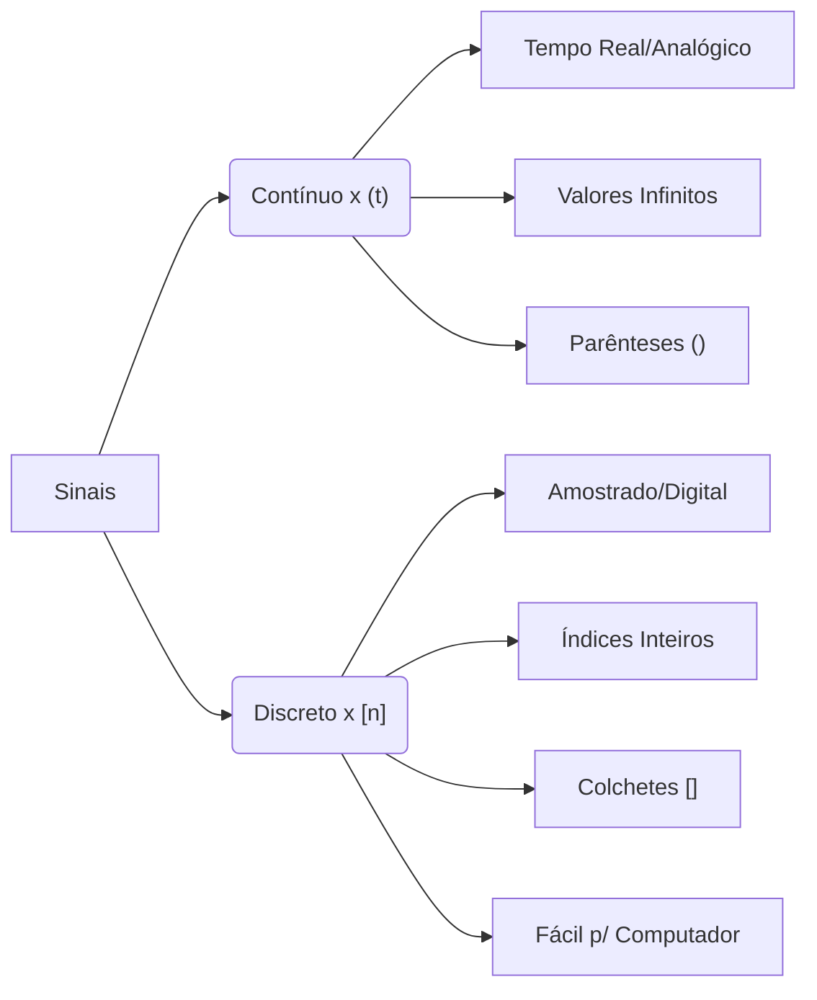
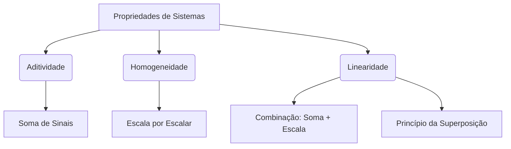
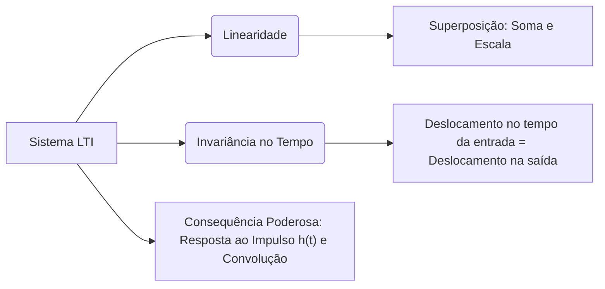

# 1. 
Assinale se o tipo de sinal descrito abaixo refere-se a um sinal contínuo ou discreto: 

- Medição de temperatura: Sinal contínuo/Sinal Discreto

- Sequência de números: Sinal contínuo/Sinal Discreto

- Sinal mais fácil de ser processado por um computador:Sinal contínuo/Sinal Discreto

- Sinal mais preciso com informação mais detalhada: Sinal contínuo/Sinal Discreto

- Sinal com a variável tempo limitada a números inteiros: Sinal contínuo/Sinal Discreto

- Representação matemática do sinal é feita como uma função cujo argumento é mostrado entre parênteses: Sinal contínuo/Sinal Discreto

Aqui está a análise ponto a ponto:

### Respostas

*   **Medição de temperatura:** **Sinal Contínuo**
    *   *Por quê?* A temperatura varia suavemente ao longo do tempo e pode assumir qualquer valor dentro de um intervalo (ex: 25,1ºC, 25,15ºC...).

*   **Sequência de números:** **Sinal Discreto**
    *   *Por quê?* Uma sequência é definida apenas em índices inteiros ($n = 0, 1, 2...$), não existindo valores "entre" os índices.

*   **Sinal mais fácil de ser processado por um computador:** **Sinal Discreto**
    *   *Por quê?* Computadores são máquinas digitais que trabalham com bits finitos. Sinais contínuos precisam ser amostrados e quantizados (transformados em discretos) para serem processados.

*   **Sinal mais preciso com informação mais detalhada:** **Sinal Contínuo** 
    *   *Por quê?* Teoricamente, um sinal contínuo contém infinita informação, pois não há perda de dados entre os instantes de tempo, ao contrário da amostragem discreta.

*   **Sinal com a variável tempo limitada a números inteiros:** **Sinal Discreto** ⏱
    *   *Por quê?* Esta é a definição clássica de tempo discreto ($t \in \mathbb{Z}$).

*   **Representação matemática... argumento entre parênteses:** **Sinal Contínuo** 
    *   *Por quê?* Na notação padrão de engenharia:
        *   Contínuo: $x(t)$ — usa parênteses.
        *   Discreto: $x[n]$ — usa colchetes.

---

### Mapa Mental Rápido: Contínuo vs. Discreto

###  Dica Cornell 

Embora isso seja teoria de sinais, entender a diferença é crucial:
*   **Dados Brutos (Contínuos):** Imagens do mundo real, áudio, sensores IoT.
*   **Pipeline ML (Discreto):** Quando você faz o *preprocessing* no Vertex AI ou usa o TensorFlow, você está lidando com tensores discretos (arrays de números). A "ponte" entre os dois é a **amostragem** e a **quantização**.

Ficou clara a distinção entre a notação $( )$ e $[ ]$? Isso costuma cair em provas de fundamentos de DSP (Processamento Digital de Sinais)!

# 2.
Complete as lacunas faltantes no texto abaixo:

"Em geral, um [Entrada, Sistemas(s), Saídas, Sinal(is)]  é responsável por modificar o  [Entrada, Sistemas(s), Saídas, Sinal(is)] de  [Entrada, Sistemas(s), Saídas, Sinal(is)] de alguma forma, a fim de gerar ou produzir um  [Entrada, Sistemas(s), Saídas, Sinal(is)] de  [Entrada, Sistemas(s), Saídas, Sinal(is)]. Enquanto  [Entrada, Sistemas(s), Saídas, Sinal(is)] são informações que nos ajudam a entender o comportamento ou a natureza de um fenômeno, um  [Entrada, Sistemas(s), Saídas, Sinal(is)]  tem a principal função de modificar ou processar estes  [Entrada, Sistemas(s), Saídas, Sinal(is)]."

Aqui está o texto completado com as opções corretas!

"Em geral, um **sistema** é responsável por modificar o **sinal** de **entrada** de alguma forma, a fim de gerar ou produzir um **sinal** de **saída**. Enquanto **sinais** são informações que nos ajudam a entender o comportamento ou a natureza de um fenômeno, um **sistema** tem a principal função de modificar ou processar estes **sinais**."

### Resumo Rápido: Sinais vs. Sistemas

| **Conceito** | **Definição** | **Exemplo no Mundo Real** | **Exemplo em Machine Learning** |
| :--- | :--- | :--- | :--- |
| **Sinal**  | Informação que carrega dados sobre um fenômeno (Entrada ou Saída). | Temperatura medida por um sensor, uma imagem, áudio. | *Features* (variáveis preditoras) ou o *target* (rótulo). |
| **Sistema**  | Entidade física ou abstrata que processa o sinal de entrada para gerar uma saída. | Um filtro de ruído, o ouvido humano, um termostato. | O modelo de ML (ex: uma Rede Neural ou Árvore de Decisão) que transforma *features* em predições. |

### Conexão 
Pense em um pipeline de MLOps no Google Cloud:
1. **Sinal de Entrada:** Dados brutos chegando.
2. **Sistema:** O pipeline de transformaçãoou o modelo treinado
3. **Sinal de Saída:** Dados limpos ou a predição final enviada para um endpoint.

**Para refletir (Estilo Socrático):**
Se um modelo de Visão Computacional recebe uma imagem (sinal de entrada) e aplica um filtro de detecção de bordas, o que *seria* considerado o "sistema" e o "sinal de saída" nesse cenário específico? 

# 3.
Relacione as colunas sobre as características de memória em sistemas e suas definições:

O sistema não possui memória e sua resposta depende apenas do valor atual da entrada [Sistema Dinâmico, Sistema Não-causal, Sistema Estatico]
O sistema possui memória interna e sua resposta depende de valores passados da entrada [Sistema Dinâmico, Sistema Não-causal, Sistema Estatico]
O sistema possui memória interna e sua resposta depende também de instantes futuros [Sistema Dinâmico, Sistema Não-causal, Sistema Estatico]

Aqui está a relação correta das colunas:

*   O sistema não possui memória e sua resposta depende apenas do valor atual da entrada: **Sistema Estático**
*   O sistema possui memória interna e sua resposta depende de valores passados da entrada: **Sistema Dinâmico**
*   O sistema possui memória interna e sua resposta depende também de instantes futuros: **Sistema Não-causal**

### Cornell Notes: Classificação de Sistemas

| **Conceito** | **Definição Chave** | **Exemplo Clássico** | **Analogia em Machine Learning** |
| :--- | :--- | :--- | :--- |
| **Estático** (Sem memória) | Saída $y(t)$ depende **apenas** de $x(t)$ no mesmo instante. | $y(t) = 2 \cdot x(t)$ | **Regressão Linear** ou MLP *Feedforward*: a predição depende apenas dos *features* da instância atual. |
| **Dinâmico** (Com memória) | Saída $y(t)$ depende de $x(t)$ e de estados passados $x(t-1), x(t-2)...$ | Circuito com capacitor ou indutor. | **Redes Neurais Recorrentes (RNN/LSTM)**: a predição depende da sequência histórica de dados (ex: séries temporais). |
| **Não-causal** | Saída depende de valores **futuros** da entrada ($x(t+1)$). | Processamento de imagem (o pixel "futuro" já está no buffer). | **Filtros de suavização *offline***: em processamento de áudio/imagem, quando temos o sinal completo salvo e podemos olhar "para frente e para trás". |

### Reflexão Socrática 

Se você estiver construindo um modelo para prever o preço de uma ação amanhã, e usar apenas os dados de *hoje* (sem olhar o histórico dos dias anteriores), que tipo de sistema você está, na prática, modelando? E se você usar uma LSTM que analisa os últimos 30 dias, como a classificação do sistema muda?

# 4.
Relacione as colunas com o nome das propriedades de um sistema de acordo com as definições destas:

A operação preserva a soma de dois sinais. [Linearidade, Aditividade, Homogeneidade]

A operação preserva tanto a soma de dois sinais quanto a multiplicação de um sinal por um escalar. [Linearidade, Aditividade, Homogeneidade]

A operação preserva a multiplicação de um sinal por um escalar [Linearidade, Aditividade, Homogeneidade]

Aqui está a relação correta:

*   A operação preserva a soma de dois sinais: **Aditividade** 
*   A operação preserva tanto a soma de dois sinais quanto a multiplicação de um sinal por um escalar: **Linearidade** 
*   A operação preserva a multiplicação de um sinal por um escalar: **Homogeneidade** 

---

### Cornell Notes: O Princípio da Superposição

| **Propriedade** | **Fórmula Matemática** | **O que significa na prática?** |
| :--- | :--- | :--- |
| **Aditividade** | $T\{x_1 + x_2\} = T\{x_1\} + T\{x_2\}$ | A resposta à soma é a soma das respostas individuais. |
| **Homogeneidade** | $T\{a \cdot x\} = a \cdot T\{x\}$ | Escalar a entrada escala a saída na mesma proporção. |
| **Linearidade** | $T\{a \cdot x_1 + b \cdot x_2\} = a \cdot T\{x_1\} + b \cdot T\{x_2\}$ | Combinação das duas anteriores (Princípio da Superposição). |

---

### Mapa Mental: Propriedades de Sistemas

### Conexão com Machine Learning

No TensorFlow ou PyTorch, uma camada `Dense` (ou `Linear`) é a aplicação prática da **Linearidade** (multiplicação de matrizes e soma de vetores). 

**Para refletir:** 
Se você empilhar várias camadas lineares em uma Rede Neural (apenas Aditividade e Homogeneidade, sem funções de ativação não-lineares), o que acontece com a capacidade do modelo de aprender padrões complexos do mundo real? Por que a *Linearidade* sozinha é uma limitação para o Deep Learning?

# 5.

Assinale a alternativa que contém a função correspondente ao gráfico da figura abaixo:

A. y(t) = u(t + 2) + 2*u(t + 1) - 2*u(t - 1) - u(t - 2)
B. y(t) = δ(t + 2) + 2*δ(t + 1) - 2*δ(t - 1) - δ(t - 2)
C. y(t) = -u(t)*t² + 3
D. y(t) = δ(t)
E. y(t) = u(t + 2) + 2u(t + 1)

A alternativa correta é a **A. y(t) = u(t + 2) + 2*u(t + 1) - 2*u(t - 1) - u(t - 2)**.

### Como chegar a essa resposta (Método dos Blocos)

A função degrau unitário, $u(t)$, age como um "interruptor" que liga (sobe 1 unidade) no tempo $t=0$. Se deslocarmos e escalarmos esse interruptor, podemos "construir" o gráfico somando as mudanças de amplitude:

*   **Em $t = -2$:** O sinal sobe de 0 para 1 (mudança de **+1**). $\rightarrow$ Adicionamos $+u(t + 2)$
*   **Em $t = -1$:** O sinal sobe de 1 para 3 (mudança de **+2**). $\rightarrow$ Adicionamos $+2u(t + 1)$
*   **Em $t = 1$:** O sinal desce de 3 para 1 (mudança de **-2**). $\rightarrow$ Adicionamos $-2u(t - 1)$
*   **Em $t = 2$:** O sinal desce de 1 para 0 (mudança de **-1**). $\rightarrow$ Adicionamos $-u(t - 2)$

Somando tudo, temos exatamente a **Alternativa A**! 

### Cornell Notes: Degrau vs. Impulso

| **Função** | **Símbolo** | **Comportamento no Gráfico** | **Analogia em ML** |
| :--- | :---: | :--- | :--- |
| **Degrau Unitário** | $u(t)$ | Mantém um valor constante após o ponto de ativação (como uma escada). | Função de ativação **ReLU** ou *Thresholding* (binarização de imagens). |
| **Impulso (Delta)** | $\delta(t)$ | Um "spike" infinito e infinitamente curto (área = 1). | Representa um evento instantâneo ou uma *feature* de impacto único (ex: um clique). |

### Reflexão Socrática

Você notou que a **Alternativa B** usa a função Delta de Dirac $\delta(t)$ com exatamente os mesmos coeficientes (1, 2, -2, -1)? 

Se nós **derivássemos** o sinal $y(t)$ do gráfico em relação ao tempo ($dy/dt$), o que aconteceria com os degraus (as linhas horizontais) e com as transições verticais (as subidas e descidas)? O gráfico resultante se pareceria com qual das alternativas? 

# 6.
"Os ruídos, são sinais em que não se pode prever com certeza um valor específico em um ponto de tempo. Em vez disso, esses sinais são caracterizados pela teoria da probabilidade e estatística. Isso significa que, em vez de uma equação matemática determinística, os ruídos são descritos por modelos estatísticos, como a distribuição de probabilidade."

O texto acima se refere a uma característica de um sinal:
A. Sinal aleatório
B. Sinal periódico
C. Sinal bilateral
D. Sinal determinístico
E. Sinal discreto

A alternativa correta é a **A. Sinal aleatório** 

### Cornell Notes: Sinais Aleatórios vs. Determinísticos

| **Tipo de Sinal** | **Característica Principal** | **Exemplo no Mundo Real** | **Conexão com Machine Learning** |
| :--- | :--- | :--- | :--- |
| **Aleatório (Estocástico)** | Não pode ser previsto com certeza; descrito por probabilidade e estatística (média, variância, distribuição). | Ruído térmico em sensores, flutuação do mercado de ações, lançamento de um dado. | O **ruído** nos dados de treino (*noise*), ou a própria natureza dos dados (ex: Distribuição Normal dos *features*). |
| **Determinístico** | Pode ser previsto com exatidão por uma equação matemática conhecida. | Onda senoidal pura ($y(t) = \sin(t)$), um cronômetro digital. | Funções de ativação, cálculos de *forward pass* em uma rede neural (sem *dropout*). |

### Por que as outras estão incorretas?
*   **B (Periódico):** Repete-se em intervalos regulares (é previsível, logo, determinístico).
*   **C (Bilateral):** Existe para tempos positivos e negativos ($t < 0$ e $t > 0$), nada a ver com imprevisibilidade.
*   **D (Determinístico):** É o **oposto** exato da descrição do texto.
*   **E (Discreto):** Refere-se apenas ao domínio do tempo (valores inteiros), não à previsibilidade.

###  Reflexão Socrática 

No contexto do seu objetivo de se tornar Engenheiro de Machine Learning: 
Se você está treinando um modelo de regressão e percebe que os **resíduos** (a diferença entre a previsão do modelo e o valor real) se comportam como um **sinal aleatório** com média zero, isso é um bom ou um mau sinal para o seu modelo? Por quê?

# 7.

Uma imagem pode ser vista como uma variação de brilho em função do espaço. Isso significa que o brilho de cada ponto da imagem é determinado pelas suas coordenadas no plano. Além disso, uma imagem pode ser considerada um sinal:

A. Sinal determinístico
B. Sinal unidimensional
C. Sinal simétrico
D. Sinal periódico
E. Sinal bidimensional

A alternativa correta é a **E. Sinal bidimensional** 

### Cornell Notes: Classificação de Sinais por Dimensão

| **Dimensão** | **Variáveis Independentes** | **Exemplo Clássico** | **Aplicação em Machine Learning** |
| :--- | :--- | :--- | :--- |
| **1D (Unidimensional)** | Tempo ($t$) ou espaço único ($x$) | Áudio, ECG, séries temporais de ações. | Processamento de Linguagem Natural (NLP) ou análise de séries temporais. |
| **2D (Bidimensional)** | Plano espacial ($x, y$) | **Imagens** em tons de cinza (brilho varia em $x$ e $y$). | **Visão Computacional**: uma imagem é uma matriz $f(x, y)$ onde cada célula é um pixel. |
| **3D (Tridimensional)** | Espaço + Tempo ($x, y, t$) ou Volume ($x, y, z$) | Vídeos, tomografias médicas (MRI/CT). | Redes 3D-CNN para análise de vídeos ou imagens médicas. |

###  Conexão com Visão Computacional
Como você busca evoluir nessa área, é crucial internalizar que, para o computador, uma imagem em tons de cinza é apenas uma **matriz 2D de números** (intensidade de brilho). Se for uma imagem colorida (RGB), ela se torna um **sinal tridimensional** (altura $\times$ largura $\times$ 3 canais de cor).

###  Reflexão Socrática

Se uma imagem é um sinal bidimensional $f(x, y)$, o que acontece com a "dimensionalidade" desse sinal quando aplicamos uma operação de *flatten* (achatamento) antes de alimentá-lo em uma rede neural totalmente conectada (Dense/MLP)? Perdemos alguma informação estrutural importante do sinal original ao fazer isso?

# 8.

Quais dos seguintes sinais pode ser considerado um sinal periódico?

A. X[t] = t
B. X[t] = log(t)
C. X[t] = ea*t
D. X[t] = sin(2π*t)
E. X[t] = t²

A alternativa correta é a **D. X[t] = sin(2π*t)** 

### Cornell Notes: Sinais Periódicos

| **Conceito** | **Definição Matemática** | **Exemplo** | **Por que as outras falham?** |
| :--- | :--- | :--- | :--- |
| **Sinal Periódico**  | Existe um período $T > 0$ tal que $x(t) = x(t + T)$ para todo $t$. O sinal se repete infinitamente. | $x(t) = \sin(2\pi t)$ (Repete a cada $T = 1$ segundo). | **A, B, C, E:** São funções monótonas ou de crescimento/decrescimento infinito. Nunca retornam ao mesmo valor de forma cíclica. |

### Conexão com Visão Computacional e ML

Sinais periódicos são a base da **Análise de Fourier**. Qualquer sinal periódico (e até muitos não periódicos) pode ser decomposto em uma soma de senos e cossenos de diferentes frequências. 
*   Em **Visão Computacional**, a Transformada de Fourier 2D é usada para analisar as frequências espaciais de uma imagem (ex: detectar padrões repetitivos, texturas ou aplicar filtros de suavização/nitidez).

### Reflexão Socrática

Se o sinal $x(t) = \sin(2\pi t)$ tem uma frequência de 1 Hz (um ciclo por segundo), e quiséssemos digitalizá-lo (transformá-lo em um sinal discreto) para processar em um modelo de ML, qual seria a **frequência mínima de amostragem** (Teorema de Nyquist) necessária para não perdermos a informação desse sinal e evitarmos o *aliasing*?

# 9.

Sistemas podem ser encontrados em diversas áreas do conhecimento e têm papel fundamental no entendimento e funcionamento de vários fenômenos. Identifique a alternativa que NÃO representa um sistema:

A. Um termômetro digital medindo a temperatura ambiente ao longo do tempo
B. Um programa de reconhecimento de voz convertendo sinais de áudio em texto
C. Um alto-falante reproduzindo música a partir de um sinal de áudio
D. Um livro contendo diversos capítulos sobre temas variados
E. Um estudante desenhando a trajetória de uma partícula em movimento

A alternativa correta é a **D. Um livro contendo diversos capítulos sobre temas variados** 

### Cornell Notes: O que define um Sistema?

| **Conceito** | **Característica Essencial** | **Exemplo** | **Por que a alternativa D falha?** |
| :--- | :--- | :--- | :--- |
| **Sistema** | Entidade que **processa** um ou mais sinais de entrada para produzir um sinal de saída (transformação). | Termômetro, alto-falante, modelo de ML. | Um livro é um **repositório estático** de informação. Ele não recebe um sinal de entrada, não o transforma e não gera uma saída dinâmica. |
| **Armazenamento Estático**  | Dados em repouso (*data at rest*). Sem processamento ativo. | HD, livro, anotações em Markdown. | Falta a relação causal de entrada $\rightarrow$ processamento $\rightarrow$ saída. |

*Nota sobre a alternativa E:* O estudante atua como um sistema biológico/cognitivo que recebe um sinal de entrada (observação da partícula), processa a informação e gera uma saída (o desenho).

### Conexão com Machine Learning e Cloud

No ecossistema:
*   **O Livro (D):** Seria equivalente a um arquivo bruto parado numa pasta. Sozinho, ele não faz nada.
*   **O Sistema (A, B, C):** Seria o Banco de dados pegando esses dados do GCS, processando-os (transformando entrada em saída) e gerando um insight ou predição.

### Reflexão Socrática

Se um livro, por si só, não é um sistema, **o que precisaríamos adicionar** a esse livro para que ele se tornasse a *entrada* de um sistema de Machine Learning moderno? (Dica: pense em como transformaríamos o texto físico em algo que um modelo de NLP pudesse processar).

# 10.

Qual das seguintes afirmações é verdadeira sobre sistemas invariantes no tempo?

A. Sistemas invariantes no tempo são sistemas que obedecem ao princípio da superposição, ou seja, se uma entrada é uma combinação de várias outras entradas menores, a saída será a soma das respostas dos componentes individuais do sinal de entrada, cada uma delas multiplicada por sua respectiva amplitude.

B. Sistemas invariantes no tempo são sistemas que operam em um único instante de tempo e não consideram variações temporais nas entradas ou respostas. Eles são comumente usados para problemas estáticos onde o tempo não é um fator relevante.

C. Sistemas invariantes no tempo são sistemas cujo comportamento ou propriedades não mudam com o tempo. Isso significa que, se a entrada do sistema for deslocada no tempo, a saída também será deslocada na mesma quantidade, mas não haverá mudanças na forma ou características da resposta do sistema ao longo do tempo

D. Sistemas invariantes no tempo são sistemas que possuem uma resposta constante e inalterada ao longo do tempo, independentemente das mudanças nas condições iniciais ou na amplitude da entrada. Esses sistemas mantêm a mesma relação entre a entrada e a saída independentemente do tempo.

E. Sistemas invariantes no tempo são sistemas que só podem ser representados e analisados no domínio da frequência, pois suas características de resposta são mais claramente visualizadas nessa representação matemática.

A alternativa correta é a **C**.

"Sistemas invariantes no tempo são sistemas cujo comportamento ou propriedades não mudam com o tempo. Isso significa que, se a entrada do sistema for deslocada no tempo, a saída também será deslocada na mesma quantidade, mas não haverá mudanças na forma ou características da resposta do sistema ao longo do tempo."

### Cornell Notes: Propriedades Fundamentais de Sistemas

| **Propriedade** | **Definição Chave** | **Fórmula / Conceito** | **O que a alternativa errada descreveu?** |
| :--- | :--- | :--- | :--- |
| **Invariância no Tempo**  | As regras do sistema não mudam com o relógio. Um atraso na entrada causa o mesmo atraso na saída. | Se $x(t) \rightarrow y(t)$, então $x(t - t_0) \rightarrow y(t - t_0)$ | **Alternativa C (Correta)** |
| **Linearidade**  | Obedece ao princípio da superposição (Aditividade + Homogeneidade). | $T\{a \cdot x_1 + b \cdot x_2\} = a \cdot T\{x_1\} + b \cdot T\{x_2\}$ | **Alternativa A** descreveu isso, não invariância. |
| **Estático (Sem memória)** | A saída depende apenas do instante atual. | $y(t) = f(x(t))$ | **Alternativa B** descreveu sistemas estáticos. |

### Mapa Mental: Sistema LTI (Linear e Invariante no Tempo)

### Conexão com Machine Learning

No contexto de **Visão Computacional**, existe um conceito análogo à invariância no tempo, chamado de **Invariância à Translação Espacial**. 
*   Uma Rede Neural Convolucional (CNN) bem treinada deve reconhecer um objeto independentemente de ele estar no canto esquerdo ou direito da imagem. O "sistema" (a CNN) aplica os mesmos filtros (pesos fixos) em toda a imagem, assim como um sistema invariante no tempo aplica a mesma regra em todos os instantes $t$.

### Reflexão Socrática

Usando sua técnica do **Palácio Mental**: imagine um sistema que é um "processador de pedidos de lanche". 
Se às 12:00 você pede um "X-Tudo" e recebe em 10 minutos, mas às 14:00 você pede o *mesmo* "X-Tudo" e o sistema agora leva 30 minutos porque o cozinheiro está cansado, esse sistema é **invariante no tempo**? O que precisaria mudar na "regra" desse sistema para que ele se tornasse invariante? 