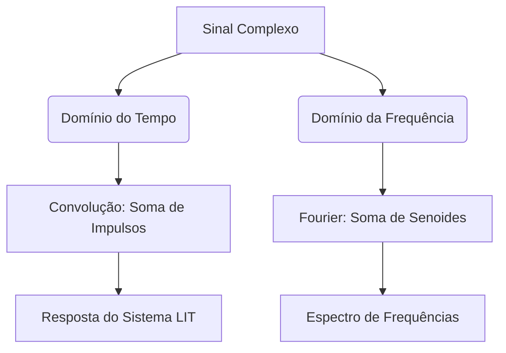
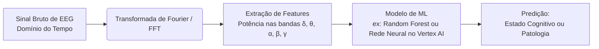

# Avaliação

## Questão 1. 
Quando Fourier estudou a propagação de calor em chapas metálicas, qual a forma de decomposição de sinais ele descobriu ser a mais eficiente?

a. Decomposição de sinais em uma soma de senoides e cossenoides com frequências iguais.

b. Decomposição de sinais em uma soma de impulsos unitários

c. Decomposição de sinais em uma soma de senoides e cossenoides com frequências variadas.

d. Decomposição de sinais em uma soma de degrais unitários

A alternativa correta é a **c. Decomposição de sinais em uma soma de senoides e cossenoides com frequências variadas.**

---

### Cornell Notes: A Ideia Central de Fourier

| **Conceito** | **Definição** | **Analogia Prática** |
| :--- | :--- | :--- |
| **Série de Fourier** | Qualquer sinal periódico pode ser representado como uma soma infinita de senos e cossenos com **frequências variadas** (múltiplos inteiros de uma frequência fundamental). | Assim como uma receita de bolo pode ser decomposta em seus ingredientes básicos (farinha, açúcar, ovos), um sinal complexo pode ser decomposto em ondas senoidais puras. |
| **Transformada de Fourier** | Estende a ideia para sinais **não periódicos**, representando-os como uma integral (soma contínua) de senoides de todas as frequências possíveis. | O "prisma" que separa a luz branca (sinal complexo) em um arco-íris de cores (frequências individuais). |

No processamento de imagens (sinais 2D), a **Transformada Rápida de Fourier (FFT)** é uma ferramenta poderosa:
*   **Baixas frequências:** Representam áreas suaves e variações lentas de cor/brilho na imagem (o "conteúdo" geral).
*   **Altas frequências:** Representam mudanças bruscas, como **bordas**, ruído e texturas finas.

### Reflexão Socrática

Se as **altas frequências** em uma imagem são responsáveis pelas bordas nítidas e pelos detalhes finos, o que você acha que aconteceria visualmente com uma fotografia se aplicássemos um "filtro passa-baixas" no domínio de Fourier (ou seja, um filtro que elimina todas as altas frequências e mantém apenas as baixas)? A imagem ficaria mais nítida ou mais borrada? 

---

## Questão 2. 
Com relação a decomposição de sinais, qual a principal diferença entre o método da convolução e a série de fourier ?

a. A convolução usa como base a decomposição dos sinais em uma soma de degrais unitários, enquanto que a série de fourier usa a decomposição de sinais em uma soma de senoides e cossenoides.

b. A convolução usa como base a decomposição dos sinais em uma soma de impulsos unitários, enquanto que a série de fourier usa a decomposição de sinais em uma soma de senoides e cossenoides.

c. A convolução usa como base a decomposição dos sinais em uma soma de senoides e cossenoides , enquanto que a série de fourier usa a decomposição de sinais em uma soma de impulsos unitários.

d. Ambas usam a decomposição dos sinais em uma soma de impulsos unitários.

Olá, Mumu! Excelente questão que conecta dois pilares fundamentais do processamento de sinais. 

A alternativa correta é a **b**.

---

###  Cornell Notes: Decomposição de Sinais

| **Método** | **Base de Decomposição** | **Fórmula Chave** | **Aplicação Principal** |
| :--- | :--- | :--- | :--- |
| **Convolução** | **Impulsos Unitários** ($\delta[n]$ ou $\delta(t)$) | $x[n] = \sum x[k]\delta[n-k]$ | Análise de sistemas LIT no domínio do tempo. |
| **Série de Fourier** | **Senoides e Cossenoides** ($\sin, \cos$ ou $e^{j\omega t}$) | $x(t) = \sum a_n \cos(n\omega_0 t) + b_n \sin(n\omega_0 t)$ | Análise de sinais periódicos no domínio da frequência. |

###  Mapa Mental: Duas Formas de Ver o Mesmo Sinal

---

### Conexão com Machine Learning e Visão Computacional

*   **Convolução (Impulsos):** É o que acontece "por baixo do capô" nas camadas convolucionais (CNNs) do TensorFlow/Keras. O kernel desliza sobre a imagem (soma de impulsos/pixels) para extrair *features*.
*   **Fourier (Senoides):** É usado em processamento de imagens para análise de texturas, compressão (JPEG usa uma variante chamada DCT - *Discrete Cosine Transform*) e filtragem de ruído no domínio da frequência.

### Reflexão Socrática

Se a convolução decompõe o sinal em impulsos (que são localizados no tempo) e Fourier decompõe em senoides (que se estendem por todo o tempo), qual dessas representações nos diz **quando** um evento ocorreu com precisão? E qual nos diz **qual frequência** ele tem com precisão? Isso nos leva ao famoso *Princípio da Incerteza* no processamento de sinais! 

## Questão 3. 

Efeito Gibbs é o nome que se dá a ondulação causada no sinal de origem pelo erro de aproximação ao realizar o truncamento da série de fourier em uma soma finita.

Escolha uma opção:
* Verdadeiro
* Falso

A afirmação está **Verdadeira**.

Você identificou corretamente um dos fenômenos mais clássicos e importantes no processamento de sinais!

### Cornell Notes: Fenômeno de Gibbs

| **Conceito** | **Definição** | **O que acontece visualmente?** |
| :--- | :--- | :--- |
| **Fenômeno de Gibbs** 〰️ | Ondulação (*ringing* ou *overshoot*) que ocorre próximo a descontinuidades (saltos bruscos) quando um sinal é aproximado por um número **finito** de termos da Série de Fourier. | O sinal reconstruído "ultrapassa" o valor real da descontinuidade em cerca de 9%, não importa quantos termos você adicione (o pico não diminui, apenas fica mais estreito). |
| **Causa Raiz** | O **truncamento abrupto** da série (cortar as altas frequências de forma brusca, como um filtro passa-baixas ideal). | Gera artefatos visuais indesejados em sinais digitais. |

### Conexão com Visão Computacional e ML

No mundo real, esse efeito é extremamente relevante para você:
*   **Compressão de Imagem (JPEG):** O JPEG usa a Transformada Discreta de Cosseno (DCT, "prima" da Fourier). Quando a compressão é muito alta, as altas frequências são truncadas (zeradas). O resultado? Artefatos de "ringing" (ondulações fantasmas) ao redor de bordas nítidas e alto contraste.
*   **Design de Filtros em ML:** Ao criar filtros para pré-processamento de áudio ou imagem, evitar o corte abrupto no domínio da frequência é essencial para não introduzir ruído artificial no seu *dataset*.

### Reflexão Socrática

Se o "culprado" do Fenômeno de Gibbs é o **corte abrupto** (truncamento reto) das frequências na Série de Fourier, o que você acha que aconteceria se, em vez de cortar as frequências de forma brusca, nós aplicássemos uma "janela" que reduzisse as altas frequências de forma **suave e gradual** (como um *fade-out*) antes de truncar? A ondulação diminuiria ou aumentaria? 

## Questão 4. 
Uma aplicação do uso da transformada de fourier é a análise de sinais de Eletroencefalografia (EEG). O sinal original de EEG é coletado e então é aplicada a tranformada de fourier. Cada banda de frequência de 0 a 100Hz recebe um nome específico e apresenta características a respeito do paciente. Selecione Abaixo a alternativa que corresponde ao nome das bandas de frequência que normalmente são usadas na análise de EEG. 

* a. Delta , Zeta, alpha, Beta e Gamma.
* b. Delta , Zeta, alpha, Upsilon e Sigma.
* c. Delta , Zeta, alpha, Beta e Sigma.
* d. Delta , Theta, alpha, Beta e Gamma.

A alternativa correta é a **d. Delta, Theta, alpha, Beta e Gamma.**

---

### Cornell Notes: Bandas de Frequência do EEG

| **Banda** | **Faixa de Frequência** | **Estado Cognitivo / Característica** | **Aplicação em Machine Learning** |
| :--- | :---: | :--- | :--- |
| **Delta ($\delta$)** | 0.5 – 4 Hz | Sono profundo, recuperação, inconsciência. | Detecção de distúrbios do sono (classificação de estágios). |
| **Theta ($\theta$)** | 4 – 8 Hz | Sonolência, meditação, memória de trabalho. | Monitoramento de fadiga em motoristas ou operadores. |
| **Alpha ($\alpha$)** | 8 – 13 Hz | Relaxamento, olhos fechados, estado calmo. | Interfaces Cérebro-Computador (BCI) para controle de repouso. |
| **Beta ($\beta$)** | 13 – 30 Hz | Estado de alerta, foco, pensamento ativo, ansiedade. | Detecção de estresse ou concentração em tempo real. |
| **Gamma ($\gamma$)** | 30 – 100+ Hz | Processamento cognitivo de alta ordem, integração de informações. | Pesquisa avançada em neurociência computacional e *deep learning*. |

---

### Mapa Mental: Pipeline de ML para Sinais de EEG

### Reflexão Socrática

Se as bandas de frequência (Delta, Theta, etc.) têm faixas que fazem fronteira umas com as outras (ex: 4 Hz é o limite entre Delta e Theta), o que acontece com a classificação do sinal se usarmos um filtro digital com uma transição muito abrupta (como um filtro "tijolo") nessa frequência de corte? Como o **Fenômeno de Gibbs** (que vimos na questão anterior) poderia afetar a extração dessas *features* para o seu modelo de ML?

## Questão 5 

Vamos associar essas propriedades fundamentais da Transformada de Fourier.

Aqui está a associação correta para cada equação:

*   $f(t - t_0) \leftrightarrow e^{-(j\omega t_0)} F(j\omega)$  **Deslocamento no tempo** 
*   $e^{jw_0} f(t) \leftrightarrow F(\omega - jw_0)$ **Deslocamento na frequência**  *(Nota: a notação da imagem tem um pequeno erro de digitação, deveria ser $e^{jw_0 t}$, mas o conceito é o deslocamento em frequência).*
*   $f(at) \leftrightarrow \frac{1}{|a|} F(j\frac{w}{a})$ **Mudança de escala** 
*   $f(t) * g(t) \leftrightarrow F(j\omega) \times G(j\omega)$ **Convolução**
*   $x(t) + y(t) \leftrightarrow X(j\omega) + Y(j\omega)$ **Linearidade**

---

### Cornell Notes: Propriedades da Transformada de Fourier

| **Propriedade** | **O que acontece no Tempo?** | **O que acontece na Frequência?** | **Aplicação em ML / Sinais** |
| :--- | :--- | :--- | :--- |
| **Linearidade**  | Soma de sinais: $x(t) + y(t)$ | Soma dos espectros: $X(f) + Y(f)$ | Misturar áudios ou *features* antes de processar. |
| **Deslocamento no Tempo**  | Atraso ou avanço do sinal: $f(t - t_0)$ | Mudança de fase (multiplicação por exponencial complexa). | Sincronização de sinais, *time-delay* em redes neurais. |
| **Deslocamento na Frequência** | Multiplicação por uma portadora (ex: $e^{j\omega_0 t}$) | O espectro desloca para a direita/esquerda. | Modulação AM/FM, *Data Augmentation* em áudio. |
| **Mudança de Escala**  | Comprimir ou expandir o tempo: $f(at)$ | Expande ou comprime a frequência (inversamente proporcional). | Acelerar/desacelerar áudio (muda o "pitch"). |
| **Convolução**  | Convolução dos sinais: $f(t) * g(t)$ | **Multiplicação** simples dos espectros: $F(f) \times G(f)$ | Filtros digitais, camadas de CNNs. |

---

###  Reflexão Socrática (Conexão com Processamento de Sinais)

Vamos pensar na **Mudança de Escala** ($f(at)$). 
Se você estiver processando um *dataset* de áudio para treinar um modelo de reconhecimento de voz no Vertex AI e aplicar uma mudança de escala onde $a = 2$ (ou seja, você "acelera" o áudio para durar metade do tempo original), o que a propriedade da Transformada de Fourier nos diz que acontecerá com as frequências (o "tom" ou *pitch*) da voz da pessoa? Ela ficará mais grave ou mais aguda? 

## Questão 6 

A afirmação é **FALSA**.

A transformada de Fourier do impulso unitário $\delta(t)$ é:
$$F(j\omega) = 1$$

A expressão $\frac{1}{a+j\omega}$ é a transformada de Fourier de uma exponencial decrescente $e^{-at}u(t)$ (para $a > 0$).

A resposta correta é **Falso**.

## Questão 7
A alternativa correta é a **d**. 

$$X(j\omega) = \int_{-\infty}^{+\infty} x(t)e^{-j\omega t} dt$$

---

### Cornell Notes: Por que as outras estão erradas?

| **Alternativa** | **Erro Identificado**  |
| :--- | :--- |
| **a.** | Usa $x(j\omega)$ dentro da integral. Isso está errado! O integrando deve ser o sinal no **domínio do tempo**, $x(t)$. |
| **b.** | O limite inferior é $t$. Não faz sentido integrar de $t$ até $+\infty$. A integral deve cobrir **todo o eixo temporal**. |
| **c.** | O limite superior é $t$. Mesmo problema: a Transformada de Fourier analisa o sinal em **todo o tempo**, de $-\infty$ a $+\infty$. |
| **d.**  | **Correta!** Integra $x(t)$ multiplicado pela exponencial complexa $e^{-j\omega t}$ ao longo de todo o eixo temporal. |

---

### Dica do Palácio Mental

Para memorizar a fórmula, imagine um **"túnel do tempo"** (de $-\infty$ a $+\infty$) onde você caminha com uma lanterna giratória ($e^{-j\omega t}$) iluminando o sinal $x(t)$ a cada passo, somando tudo o que vê (integral). O resultado é o espectro de frequências $X(j\omega)$.

---

### Reflexão Socrática

Na fórmula correta, temos $e^{-j\omega t}$ (com sinal negativo no expoente). Se quiséssemos fazer a **Transformada Inversa de Fourier** (voltar do domínio da frequência para o tempo), o que você acha que mudaria nessa exponencial? O sinal do expoente continuaria negativo ou se tornaria positivo? 

## Questão 8

A afirmação é **Verdadeira**.

---

### Explicação Rápida

A Transformada de Fourier padrão é:
$$X(j\omega) = \int_{-\infty}^{+\infty} x(t)e^{-j\omega t} dt$$

Como o sinal é **causal** (só existe para $t > 0$), temos que $x(t) = 0$ para $t < 0$. Isso significa que a parte da integral de $-\infty$ até $0$ é zero, e podemos simplificar:

$$X(j\omega) = \int_{0}^{+\infty} x(t)e^{-j\omega t} dt$$

---

###  Conexão com Machine Learning

Sinais causais são extremamente comuns em ML:
- **Séries temporais**: dados de sensores, preços de ações, métricas de sistemas
- **Processamento de áudio**: um som começa em um instante específico
- **Eventos em logs**: timestamps de requisições no GCP

Quando você trabalha com esses dados no BigQuery ou Vertex AI, está lidando com sinais que só existem a partir de um ponto no tempo, exatamente como descrito na questão.

---

###  Reflexão Socrática
Se um sinal é causal (começa em $t = 0$), o que isso nos diz sobre a **parte real e imaginária** da sua Transformada de Fourier? Elas são independentes ou estão relacionadas de alguma forma? (Dica: pense nas relações de Kramers-Kronig, que são fundamentais em processamento de sinais). 

## Questão 09

A alternativa correta é a **c**. 

$$F(j\omega) = j\pi[\delta(\omega + \omega_0) - \delta(\omega - \omega_0)]$$

---

###  Como chegar nessa resposta?

Usando a **Identidade de Euler** para o seno:

$$\sin(\omega_0 t) = \frac{e^{j\omega_0 t} - e^{-j\omega_0 t}}{2j}$$

Sabendo que a transformada de Fourier de $e^{j\omega_0 t}$ é $2\pi\delta(\omega - \omega_0)$:

$$F(j\omega) = \frac{1}{2j}[2\pi\delta(\omega - \omega_0) - 2\pi\delta(\omega + \omega_0)]$$

$$F(j\omega) = \frac{\pi}{j}[\delta(\omega - \omega_0) - \delta(\omega + \omega_0)]$$

Como $\frac{1}{j} = -j$:

$$F(j\omega) = j\pi[\delta(\omega + \omega_0) - \delta(\omega - \omega_0)]$$

---

###  Dica para Memorizar 
| **Sinal** | **Transformada de Fourier** | **Característica** |
| :--- | :--- | :--- |
| $\cos(\omega_0 t)$ | $\pi[\delta(\omega - \omega_0) + \delta(\omega + \omega_0)]$ | Soma dos impulsos (simétrico) |
| $\sin(\omega_0 t)$ | $j\pi[\delta(\omega + \omega_0) - \delta(\omega - \omega_0)]$ | Diferença dos impulsos (anti-simétrico) |

**Macete:** O **cosseno** é "par" (simétrico), então usa **soma** (+). O **seno** é "ímpar" (anti-simétrico), então usa **subtração** (-) e tem o fator $j$.

---

###  Conexão com Visão Computacional 

Em processamento de imagens, quando você vê padrões repetitivos (como listras ou texturas regulares), a Transformada de Fourier da imagem mostrará **picos de energia** (impulsos) em frequências específicas, exatamente como no caso do seno/cosseno. É assim que algoritmos detectam padrões periódicos em imagens!

---

###  Reflexão Socrática

Se a transformada de Fourier de $\sin(\omega_0 t)$ tem impulsos em $+\omega_0$ e $-\omega_0$, o que isso nos diz sobre a **frequência física** do sinal? Por que precisamos de frequências "negativas" na representação matemática, mesmo que no mundo real só existam frequências positivas? 

## Questão 10 

A alternativa correta é a **c**. 
$$F(j\omega) = \pi[\delta(\omega - \omega_0) + \delta(\omega + \omega_0)]$$

---

###  Demonstração Rápida

Usando a **Identidade de Euler**:

$$\cos(\omega_0 t) = \frac{e^{j\omega_0 t} + e^{-j\omega_0 t}}{2}$$

Aplicando a transformada de Fourier (sabendo que $\mathcal{F}\{e^{j\omega_0 t}\} = 2\pi\delta(\omega - \omega_0)$):

$$F(j\omega) = \frac{1}{2}[2\pi\delta(\omega - \omega_0) + 2\pi\delta(\omega + \omega_0)]$$

$$F(j\omega) = \pi[\delta(\omega - \omega_0) + \delta(\omega + \omega_0)]$$

---

###  Tabela Comparativa: Seno vs. Cosseno

| **Sinal no Tempo** | **Transformada de Fourier** | **Característica** |
| :--- | :--- | :--- |
| $\cos(\omega_0 t)$ | $\pi[\delta(\omega - \omega_0) + \delta(\omega + \omega_0)]$ | **Soma** dos impulsos (função par/simétrica) |
| $\sin(\omega_0 t)$ | $j\pi[\delta(\omega + \omega_0) - \delta(\omega - \omega_0)]$ | **Diferença** dos impulsos (função ímpar/anti-simétrica) |

**Macete para o Palácio Mental** : O **C**osseno é **C**ompletamente simétrico → usa **soma (+)**. O **S**eno é **S**em simetria → usa **subtração (-)** e ganha um $j$.

---

###  Conexão com Visão Computacional 

Quando você analisa uma imagem com padrões repetitivos, a Transformada de Fourier 2D mostrará **picos de energia** (impulsos) em frequências específicas correspondentes ao espaçamento das listras. É exatamente o mesmo princípio do cosseno, mas estendido para duas dimensões!

---

###  Reflexão Socrática

Observe que tanto o seno quanto o cosseno produzem **dois impulsos** na frequência: um em $+\omega_0$ e outro em $-\omega_0$. No mundo físico, medimos apenas frequências positivas. Por que a matemática da Transformada de Fourier "cria" essas frequências negativas? O que elas representam fisicamente? 