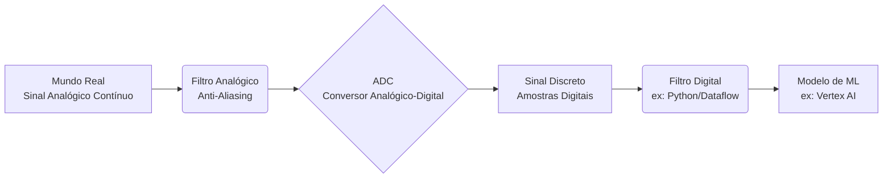
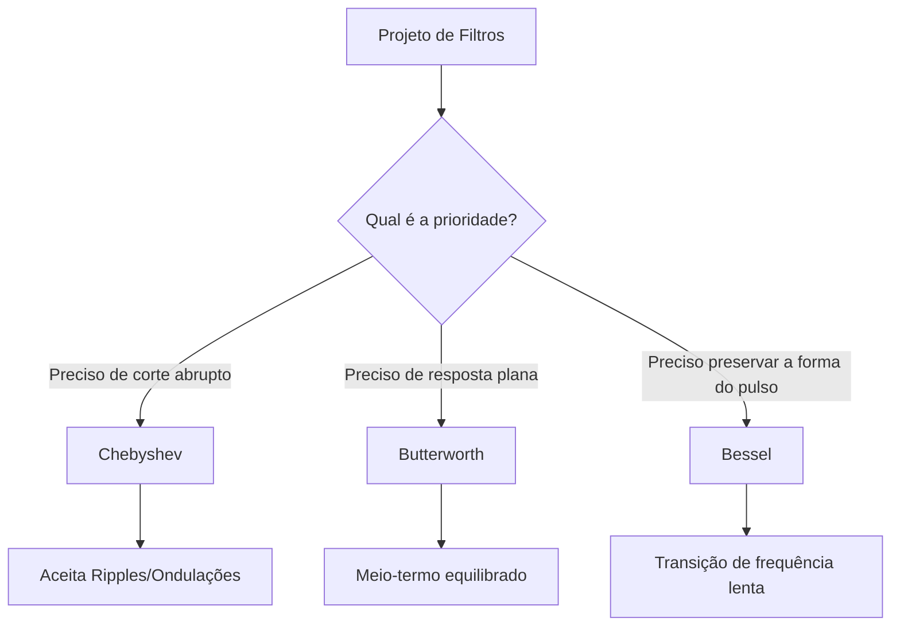
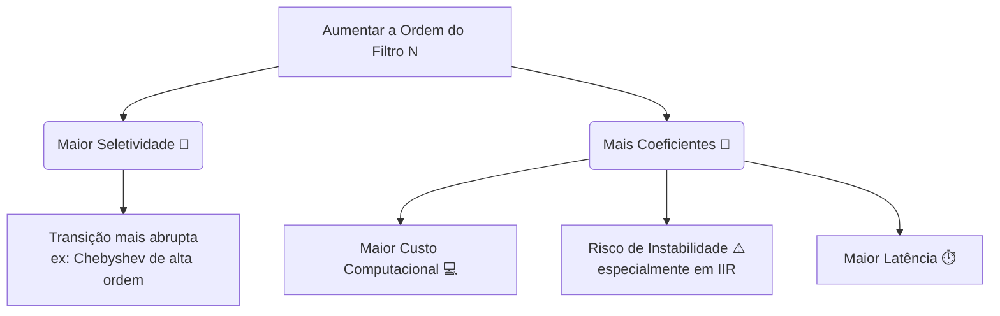
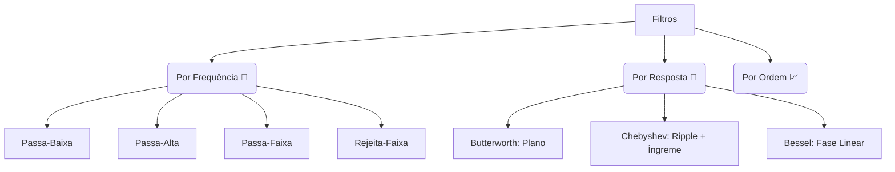

# 1. 
Assinale as figuras com o tipo de filtro que é representado a seguir: [ Rejeita faixa, Passa Alta, Passa Baixa, Passa Faixa] 

O filtro representado no gráfico é um **Filtro Passa-Baixa**. 

---

###  Cornell Notes: Tipos de Filtros

| **Tipo de Filtro** | **Comportamento** | **Aplicação Típica** |
| :--- | :--- | :--- |
| **Passa-Baixa**  | Permite frequências **abaixo** de $f_c$, atenua as altas. | Remover ruído de alta frequência, suavizar imagens (blur). |
| **Passa-Alta**  | Permite frequências **acima** de $f_c$, atenua as baixas. | Detecção de bordas em imagens, realce de detalhes. |
| **Passa-Faixa**  | Permite apenas uma **faixa específica** de frequências. | Isolamento de bandas de EEG (ex: apenas Alpha 8-13Hz). |
| **Rejeita-Faixa**  | Rejeita uma **faixa específica**, permite o resto. | Remover interferência de 60Hz (ruído de rede elétrica). |

---

### Pontos-Chave do Gráfico

- **$f_c$ (Frequência de Corte):** Ponto onde a amplitude cai para $0.707 \cdot V_{máx}$ (equivalente a **-3 dB**). É o limite da banda de passagem.
- **Banda de Passagem:** Frequências que passam com pouca atenuação ($0$ até $f_c$).
- **Banda de Transição:** Região entre $f_c$ e $f_s$ onde o filtro começa a atenuar.
- **Banda de Atenuação:** Frequências acima de $f_s$ que são fortemente rejeitadas.

---

###  Conexão com Visão Computacional 
Em processamento de imagens, um **filtro passa-baixa** no domínio da frequência (como um filtro Gaussiano) remove as altas frequências, que correspondem a bordas nítidas e ruído. O resultado é uma imagem **suavizada** (blur), útil para reduzir ruído antes de aplicar detecção de bordas ou segmentação.

---

# Questão 2
Sobre as faixas de frequências trabalhadas em filtros digitais, associe cada termo à sua definição correspondente:

É uma área onde se determina a precisão do filtro na separação das frequências desejadas das indesejadas. [ Banda de Passagem,  Banda de Atenuação e  Banda de Transição]

É a faixa de frequências na qual o filtro atinge um maior valor para as frequências de interesse. É onde ocorre a preservação das informações que desejamos manter. [ Banda de Passagem,  Banda de Atenuação e  Banda de Transição]

É a faixa de frequências na qual o filtro bloqueia a passagem das frequências indesejadas. [ Banda de Passagem,  Banda de Atenuação e  Banda de Transição]

Olá, Mumu! Vamos associar esses conceitos fundamentais de projeto de filtros digitais. 

Aqui está a associação correta:

*   É uma área onde se determina a precisão do filtro na separação das frequências desejadas das indesejadas: **Banda de Transição** 
*   É a faixa de frequências na qual o filtro atinge um maior valor para as frequências de interesse. É onde ocorre a preservação das informações que desejamos manter: **Banda de Passagem**
*   É a faixa de frequências na qual o filtro bloqueia a passagem das frequências indesejadas: **Banda de Atenuação** (ou Banda de Rejeição)

---

### Cornell Notes: Especificações de um Filtro Digital

| **Faixa de Frequência** | **Definição Técnica** | **Parâmetro de Projeto** |
| :--- | :--- | :--- |
| **Banda de Passagem** | Frequências que passam com atenuação mínima (ex: $0$ a $f_p$). | *Ripple* de passagem (variação máxima permitida, ex: 1 dB). |
| **Banda de Transição** | Região entre a passagem e a atenuação ($f_p$ a $f_s$). | Largura da transição ($\Delta f = f_s - f_p$). Quanto menor, mais "íngreme" o filtro. |
| **Banda de Atenuação** | Frequências que devem ser suprimidas (acima de $f_s$). | Atenuação mínima (ex: -40 dB ou -60 dB). |

---

###  Conexão com Machine Learning 
*   **Banda de Passagem:** 300 Hz a 3400 Hz (faixa típica da voz humana).
*   **Banda de Atenuação:** Abaixo de 300 Hz (ruído de motor/vento) e acima de 3400 Hz (ruído agudo/chiado).
Isso melhora a acurácia do modelo ao remover *features* de ruído que não contribuem para a classificação.

---

# Questão 3 
Assinale se as alternativas são verdadeiras ou falsas:

Ao aplicar filtros digitais aos sinais de entrada, é possível remover ruídos indesejados, realçar componentes importantes e adaptar o sinal para atender às necessidades

Um filtro digital é um sistema que altera as características de um sinal, como amplitude, fase e frequência.

Atualmente existem apenas filtros digitais, pois, os analógicos são considerados "ultrapassados".

O filtro digital emprega circuitos eletrônicos compostos por componentes como resistores e capacitores para realizar a tarefa de filtragem.

Aqui está o gabarito comentado:

1. Ao aplicar filtros digitais aos sinais de entrada, é possível remover ruídos indesejados, realçar componentes importantes e adaptar o sinal para atender às necessidades.
    **Verdadeiro**  *(Esta é a definição exata do propósito de um filtro).*

2. Um filtro digital é um sistema que altera as características de um sinal, como amplitude, fase e frequência.
    **Verdadeiro**  *(Ao atenuar ou realçar frequências, o filtro modifica naturalmente a amplitude e a fase do sinal original).*

3. Atualmente existem apenas filtros digitais, pois, os analógicos são considerados "ultrapassados".
    **Falso**  *(Filtros analógicos são **essenciais** e insubstituíveis em certas etapas, como o filtro "anti-aliasing" antes de um conversor analógico-digital, ou em circuitos de radiofrequência e fontes de alimentação).*

4. O filtro digital emprega circuitos eletrônicos compostos por componentes como resistores e capacitores para realizar a tarefa de filtragem.
    **Falso**  *(Esta é a descrição de um **filtro analógico**. O filtro digital é um **algoritmo matemático** executado em software ou hardware digital, como CPUs, GPUs, DSPs ou FPGAs).*

---

###  Cornell Notes: Analógico vs. Digital

| **Característica** | **Filtro Analógico** 🔌 | **Filtro Digital**  |
| :--- | :--- | :--- |
| **Implementação** | Componentes físicos (resistores, capacitores, indutores, amplificadores operacionais). | Algoritmos matemáticos (equações de diferença) em código (Python, C++) ou hardware digital. |
| **Flexibilidade** | Baixa. Mudar a frequência de corte exige trocar componentes físicos. | Alta. Basta alterar uma variável no código (ex: coeficientes do filtro). |
| **Custo/Complexidade** | Barato para funções simples, mas complexo para filtros de alta ordem. | Custo computacional (CPU/GPU), mas escalável e reutilizável. |
| **Exemplo Prático** | Filtro passa-baixa RC em um microfone. | Filtro `scipy.signal.butter` aplicado a um array NumPy antes de treinar um modelo. |

---

### Mapa Mental: O Pipeline Real de Sinais

Para um Engenheiro de ML, é crucial entender que o mundo é analógico, mas o modelo é digital:

---

### Conexão com seu Objetivo (ML Engineer / Visão Computacional)
Quando você trabalha com sensores (IoT, câmeras, microfones) ingerindo dados no **Google Cloud (Pub/Sub -> Dataflow)**, os dados já chegaram digitalizados. Porém, a qualidade do seu modelo de *Deep Learning* depende diretamente de como esse sinal foi tratado **antes** e **durante** a digitalização. Um bom pipeline de MLOps sempre considera a qualidade da amostragem.

---
# Questão 04
Associe cada estilo de filtro à sua definição:

Esse filtro possui uma resposta em frequência com uma transição abrupta entre a banda de passagem e a banda de rejeição. Ele pode ser projetado para ter uma atenuação muito alta na banda de rejeição, mas isso resulta em uma resposta com ripples (ondulações) na banda de passagem. [Butterwoth, Chebyshev, Bessel]

Esse filtro possui uma resposta em frequência que apresenta uma transição mais suave entre a banda de passagem e a banda de rejeição. Isso significa que a banda de transição tem uma curva mais gradual, proporcionando uma melhor preservação das características do sinal nas frequências próximas à frequência de corte. [Butterwoth, Chebyshev, Bessel]

Esse filtro é caracterizado por ter uma resposta em frequência que cai gradualmente à medida que a frequência se afasta da frequência de corte. Ele fornece uma atenuação constante por oitava e não apresenta overshoot (superelevação) na resposta ao impulso. [Butterwoth, Chebyshev, Bessel] 

Aqui está a associação correta:

*   Esse filtro possui uma resposta em frequência com uma transição abrupta... resulta em uma resposta com **ripples (ondulações)** na banda de passagem: **Chebyshev** 〰️
*   Esse filtro possui uma resposta em frequência que apresenta uma transição mais suave... proporcionando uma **melhor preservação** (maximamente plana) nas frequências próximas à corte: **Bessel**
*   Esse filtro é caracterizado por cair gradualmente... e **não apresenta overshoot** (superelevação) na resposta ao impulso: **Butterwoth** 

---

###  Cornell Notes: Os 3 Grandes Filtros Analógicos/Digitais

| **Tipo de Filtro** | **Foco Principal** | **Domínio da Frequência**  | **Domínio do Tempo**  | **Aplicação em ML / Engenharia** |
| :--- | :--- | :--- | :--- | :--- |
| **Butterworth** | Compromisso equilibrado | **Maximamente plano** na banda de passagem (sem ripples). Transição moderada. | Resposta ao degrau com *overshoot* moderado. | Padrão "go-to" para suavização geral de dados quando não há requisitos extremos. |
| **Chebyshev** | Seletividade (Corte abrupto) | Transição **muito abrupta**, mas com **ripples** (ondulações) na banda de passagem (Tipo I) ou de rejeição (Tipo II). | *Overshoot* e *ringing* mais pronunciados. | Quando é crítico separar duas frequências muito próximas, mesmo que distorça um pouco a amplitude. |
| **Bessel** | Preservação da forma de onda | Transição **muito suave** e gradual (pior seletividade em frequência). | **Fase linear** (atraso de grupo constante). **Zero overshoot**. | Processamento de pulsos, ECG, ou qualquer sinal onde a *forma* da onda no tempo é mais importante que a frequência exata. |

---

###  Mapa Mental: O *Trade-off* dos Filtros

---

###  Conexão com Machine Learning 

*   Se você usar um filtro **Chebyshev** para isolar uma frequência específica de falha, os *ripples* na banda de passagem podem criar "falsos positivos" (artefatos) que o seu modelo de ML interpretará erroneamente como anomalias.
*   Se a forma do pico de vibração (o *transiente*) for a *feature* mais importante para o seu modelo, um filtro **Bessel** é a escolha correta, pois ele não distorce o formato do pico no tempo.

---

# Questão 05
Analisando a figura abaixo de um filtro Passa-Faixa, faça o que se pede.
Na figura são apresentadas alguns elementos de forma genérica, correlacione as colunas dos elementos com seus significados.

Frequência de corte inferior

Banda passante

Frequência de corte superior

Banda de atenuação

Frequência de atenuação mínima

Olá, Mumu! Vamos analisar esse gráfico de filtro Passa-Faixa com atenção.

Aqui está a correlação correta dos elementos:

| **Elemento** | **Correlação** |
| :--- | :--- |
| Frequência de corte inferior | **F1** |
| Banda passante | **B0** |
| Frequência de corte superior | **F2** |
| Banda de atenuação | **B1** (ou B2, ambas são bandas de atenuação) |
| Frequência de atenuação mínima | **F0** |

---

### Cornell Notes: Filtro Passa-Faixa

| **Parâmetro** | **Definição** | **No Gráfico** |
| :--- | :--- | :--- |
| **f1** | Frequência de corte inferior (-3 dB) | Início da banda passante |
| **f2** | Frequência de corte superior (-3 dB) | Fim da banda passante |
| **f0** | Frequência central (pico de máxima passagem) | Centro do filtro |
| **B0** | Banda passante (BW = f2 - f1) | Região entre f1 e f2 |
| **B1, B2** | Bandas de atenuação | Abaixo de f1 e acima de f2 |

---

### Conexão com Machine Learning e EEG

Lembra da questão sobre as bandas de EEG (Delta, Theta, Alpha, Beta, Gamma)? Um filtro **Passa-Faixa** é exatamente o que usamos para isolar cada uma dessas bandas!

Por exemplo, para extrair apenas a banda **Alpha (8-13 Hz)** de um sinal de EEG:
- **f1** = 8 Hz
- **f2** = 13 Hz
- **B0** = 5 Hz (largura da banda)
- **f0** = 10.5 Hz (frequência central)

---

# Questão 06

A alternativa correta é a **A. Filtro Chebyshev**

---

### Por que é Chebyshev?

Observando o gráfico, a característica **definitiva** é a presença de **ripples (ondulações)** na banda de passagem (região antes de $f/f_0 = 1.0$). Você pode ver claramente as curvas oscilando acima e abaixo de 1.0, especialmente nas ordens mais altas (3, 4, 5).

| **Característica Observada** | **O que indica** |
| :--- | :--- |
| Ondulações na banda de passagem | **Chebyshev Tipo I** |
| Transição abrupta após $f/f_0 = 1.0$ | Alta seletividade (trade-off pelos ripples) |
| Ordens maiores = transição mais íngreme | Comportamento típico de filtros IIR |

---

### Comparação Rápida

| **Filtro** | **Banda de Passagem** | **Transição** |
| :--- | :--- | :--- |
| **Butterworth** | Maximamente plana (sem ripples) | Moderada |
| **Chebyshev** | **Com ripples (ondulações)** | **Abrupta** |
| **Bessel** | Plana | Muito suave |

---

### Conexão com ML

No pré-processamento de sinais para ML, filtros Chebyshev são úteis quando você precisa de **corte abrupto** (separar frequências próximas), mas os ripples podem introduzir artefatos. Em aplicações como processamento de áudio ou EEG no Vertex AI, você precisa avaliar se as ondulações afetam a qualidade das *features* extraídas.

----

# Questão 7

O que é a ordem de um filtro digital e qual é a sua importância na concepção de filtros?

A. A ordem de um filtro digital refere-se ao número de vezes que o sinal de entrada é amostrado pelo filtro em um determinado período de tempo. Quanto maior a ordem, maior o número de amostras do sinal, o que pode levar a uma maior perda de informação e resolução do sinal original. Portanto, é importante manter a ordem do filtro o mais baixa possível para preservar a integridade do sinal.

B. A ordem de um filtro digital está relacionada com a frequência de corte do filtro. Quanto maior a ordem, maior é a frequência de corte possível, permitindo a filtragem de sinais em frequências mais altas.

C. A ordem de um filtro digital refere-se ao número de amostras que o filtro utiliza para processar o sinal de entrada. Uma ordem mais alta implica em uma maior latência do filtro, o que pode ser prejudicial em aplicações em tempo real.

D. A ordem de um filtro digital representa o grau do filtro e está diretamente relacionada à sua complexidade. Filtros de ordem mais alta podem proporcionar uma resposta de frequência mais seletiva, mas também aumentam a complexidade computacional e podem causar problemas de estabilidade em certas aplicações.

E. A ordem de um filtro digital refere-se à quantidade de bits que o filtro utiliza para representar os coeficientes de filtro. Quanto maior a ordem, maior a precisão dos coeficientes e, consequentemente, maior a qualidade do filtro.

A alternativa correta é a **D**. ✅

"A ordem de um filtro digital representa o grau do filtro e está diretamente relacionada à sua complexidade. Filtros de ordem mais alta podem proporcionar uma resposta de frequência mais seletiva, mas também aumentam a complexidade computacional e podem causar problemas de estabilidade em certas aplicações."

---

### 📝 Cornell Notes: A Ordem do Filtro (N)

| **Conceito** | **Impacto no Filtro** | **Trade-off (Custo x Benefício)** |
| :--- | :--- | :--- |
| **Seletividade** 🎯 | Quanto maior a ordem, mais **íngreme** é a transição entre a banda de passagem e a de rejeição (parece mais um "muro"). | ✅ Melhor separação de frequências. |
| **Complexidade Computacional** 💻 | Exige mais multiplicações e somas por amostra (mais coeficientes). | ❌ Maior latência e consumo de CPU/GPU. |
| **Estabilidade** ⚠️ | Em filtros **IIR** (resposta ao impulso infinita), ordens muito altas podem mover os polos para fora do círculo unitário, causando instabilidade (o sinal "explode"). | ❌ Risco de falha em tempo real. |
| **Fase** 🌊 | Filtros de alta ordem tendem a introduzir maior atraso de grupo (distorção de fase), exceto se forem projetados com fase linear (como FIR). | ❌ Pode distorcer a forma da onda no tempo. |

---

### 🗺️ Mapa Mental: O Dilema da Ordem do Filtro

---

### 💡 Conexão com Machine Learning e GCP ☁️

Como futuro **Engenheiro de Machine Learning**, você precisará equilibrar esse *trade-off* ao implantar modelos:
*   **Pipeline de Dados (Dataflow):** Um filtro de ordem muito alta em um fluxo de dados de áudio em tempo real pode causar *backlog* e aumentar a latência da inferência no Vertex AI.
*   **Edge Computing (Dispositivos IoT):** Se o filtro for executado na borda (ex: TensorFlow Lite em um microcontrolador), a memória e a potência de processamento são limitadas. Uma ordem menor (mesmo que com transição mais suave) é frequentemente preferível.

---

A alternativa correta é a **B. Passa-Alta** ✅

---

### 📝 Análise do Gráfico

| **Característica Observada** | **O que indica** |
| :--- | :--- |
| Amplitude próxima de zero em **baixas frequências** (antes de $f_c$) | Banda de **rejeição** à esquerda |
| Amplitude atinge $0.707 \cdot V_{máx}$ em $f_c$ | Ponto de corte (-3 dB) |
| Amplitude constante em $V_{máx}$ para frequências **acima de $f_c$** | Banda de **passagem** à direita |

👉 O filtro **deixa passar apenas as frequências altas** (acima de $f_c$) e bloqueia as baixas.

---

### 🧠 Comparação Rápida dos Tipos de Filtro

| **Tipo de Filtro** | **Banda de Passagem** | **Banda de Rejeição** |
| :--- | :--- | :--- |
| **Passa-Baixa** | $0$ até $f_c$ | Acima de $f_c$ |
| **Passa-Alta** ✅ | Acima de $f_c$ | $0$ até $f_c$ |
| **Passa-Faixa** | Entre $f_1$ e $f_2$ | Abaixo de $f_1$ e acima de $f_2$ |
| **Rejeita-Faixa** | Abaixo de $f_1$ e acima de $f_2$ | Entre $f_1$ e $f_2$ |

---

### 💡 Conexão com Visão Computacional 👁️

Em processamento de imagens, um **filtro passa-alta** no domínio da frequência realça as **altas frequências espaciais**, que correspondem a:
- **Bordas nítidas** 📐
- **Detalhes finos** 🔍
- **Ruído** (infelizmente também!)

É a base de algoritmos como **Sobel**, **Laplaciano** e **Canny Edge Detector** — essenciais para detectar contornos em imagens antes de alimentar uma CNN no Vertex AI.

---

### 🤔 Reflexão Socrática

Se você aplicar um filtro **passa-alta** em uma imagem em tons de cinza, o que acontecerá visualmente com as áreas de cor uniforme (como um céu azul sem nuvens ou uma parede lisa)? Elas ficarão mais visíveis, desaparecerão ou se transformarão em algo diferente? E por que isso é útil para detectar objetos em Visão Computacional? 🖼️🧠

----

A alternativa correta é a **B. Passa-Alta** ✅

---

### 📝 Análise do Gráfico

| **Característica Observada** | **O que indica** |
| :--- | :--- |
| Amplitude próxima de zero em **baixas frequências** (antes de $f_c$) | Banda de **rejeição** à esquerda |
| Amplitude atinge $0.707 \cdot V_{máx}$ em $f_c$ | Ponto de corte (-3 dB) |
| Amplitude constante em $V_{máx}$ para frequências **acima de $f_c$** | Banda de **passagem** à direita |

👉 O filtro **deixa passar apenas as frequências altas** (acima de $f_c$) e bloqueia as baixas.

---

### 🧠 Comparação Rápida dos Tipos de Filtro

| **Tipo de Filtro** | **Banda de Passagem** | **Banda de Rejeição** |
| :--- | :--- | :--- |
| **Passa-Baixa** | $0$ até $f_c$ | Acima de $f_c$ |
| **Passa-Alta** ✅ | Acima de $f_c$ | $0$ até $f_c$ |
| **Passa-Faixa** | Entre $f_1$ e $f_2$ | Abaixo de $f_1$ e acima de $f_2$ |
| **Rejeita-Faixa** | Abaixo de $f_1$ e acima de $f_2$ | Entre $f_1$ e $f_2$ |

---

### 💡 Conexão com Visão Computacional 👁️

Em processamento de imagens, um **filtro passa-alta** no domínio da frequência realça as **altas frequências espaciais**, que correspondem a:
- **Bordas nítidas** 📐
- **Detalhes finos** 🔍
- **Ruído** (infelizmente também!)

É a base de algoritmos como **Sobel**, **Laplaciano** e **Canny Edge Detector** — essenciais para detectar contornos em imagens antes de alimentar uma CNN no Vertex AI.

---

### 🤔 Reflexão Socrática

Se você aplicar um filtro **passa-alta** em uma imagem em tons de cinza, o que acontecerá visualmente com as áreas de cor uniforme (como um céu azul sem nuvens ou uma parede lisa)? Elas ficarão mais visíveis, desaparecerão ou se transformarão em algo diferente? E por que isso é útil para detectar objetos em Visão Computacional? 🖼️🧠

----
Questão 9
Considere a necessidade de projetar um filtro Passa-Baixa do tipo Butterworth com as seguintes restrições:

A frequência de corte deve ser de 30 kHz;
É necessário garantir uma atenuação de pelo menos 20 dB para frequência maiores que 50 kHz;
O filtro deve prover uma planura de no máximo 1 dB na banda passante, para frequências menores que 25 kHz;
Qual a ordem mínima requerida para atender essas restrições? 

A. 3
B. 5
C. 2
D. 4
E. 1

A alternativa correta é a **B. 5** ✅

---

### 📝 Resolução Passo a Passo

Para um filtro **Butterworth** de ordem $N$, a atenuação em dB é dada por:

$$A(f) = 10 \cdot \log_{10}\left(1 + \left(\frac{f}{f_c}\right)^{2N}\right)$$

Onde $f_c = 30 \text{ kHz}$.

Precisamos atender **duas condições simultaneamente**:

#### ✅ Condição 1: Banda Passante (f = 25 kHz)
A atenuação deve ser **no máximo 1 dB**:
$$A(25\text{k}) = 10 \cdot \log_{10}\left(1 + \left(\frac{25}{30}\right)^{2N}\right) \leq 1 \text{ dB}$$

#### ✅ Condição 2: Banda de Rejeição (f = 50 kHz)
A atenuação deve ser **pelo menos 20 dB**:
$$A(50\text{k}) = 10 \cdot \log_{10}\left(1 + \left(\frac{50}{30}\right)^{2N}\right) \geq 20 \text{ dB}$$

---

### 🧮 Testando as Ordens

| **Ordem (N)** | **A(25 kHz)** | **Atende ≤ 1 dB?** | **A(50 kHz)** | **Atende ≥ 20 dB?** |
| :---: | :---: | :---: | :---: | :---: |
| 1 | 2.29 dB | ❌ | 4.44 dB | ❌ |
| 2 | 1.71 dB | ❌ | 8.13 dB | ❌ |
| 3 | 1.25 dB | ❌ | 11.94 dB | ❌ |
| 4 | 0.91 dB | ✅ | 13.93 dB | ❌ |
| **5** | **0.65 dB** | ✅ | **21.02 dB** | ✅ |

---

### 💡 Conexão com Machine Learning

No **Google Cloud**, ao projetar pipelines de processamento de sinais (ex: áudio para *Speech-to-Text* no Vertex AI), você precisa balancear:
- **Ordem baixa**: Menor custo computacional, mas pode não atender especificações rigorosas.
- **Ordem alta**: Atende especificações, mas aumenta latência e consumo de recursos.

A ordem **5** é o ponto ótimo aqui: atende ambas as restrições com margem de segurança.

---

### 🤔 Reflexão Socrática

Se você precisasse reduzir a ordem do filtro para **N = 3** (para economizar recursos computacionais), qual das duas especificações você teria que relaxar: a **planura na banda passante** (aceitar mais de 1 dB de atenuação em 25 kHz) ou a **atenuação na banda de rejeição** (aceitar menos de 20 dB em 50 kHz)? Qual impacto isso teria na qualidade do sinal para um modelo de ML? 📉🧠

----

# Questão 10

Questão 10 
Assinale a alternativa que apresenta as classificações dos tipos de filtro quanto a banda passante de frequência.

A. Passa-Baixa, Passa-Alta, Passa-Faixa, Rejeita-Faixa
B. Filtro Chebyshev, filtro Bessel, filtro Butterworth
C. Função impulso, função degrau, função rampa
D. Filtro de 1° ordem, 2° ordem, 3° ordem
E. Amplitude, fase, frequência,

A alternativa correta é a **A. Passa-Baixa, Passa-Alta, Passa-Faixa, Rejeita-Faixa** ✅

---

### 📝 Cornell Notes: Classificação de Filtros

| **Critério de Classificação** | **Exemplos** | **O que define?** |
| :--- | :--- | :--- |
| **Por Banda de Frequência** 🌊 | Passa-Baixa, Passa-Alta, Passa-Faixa, Rejeita-Fixa (Notch) | **Quais frequências** o filtro deixa passar ou bloqueia. (Alternativa A) |
| **Por Resposta/Aproximação** 📐 | Butterworth, Chebyshev, Bessel, Elíptico | **Como** é a forma da curva de transição (plana, com ripple, fase linear). (Alternativa B) |
| **Por Ordem** 📈 | 1ª ordem, 2ª ordem, N-ésima ordem | A **inclinação** da atenuação e a complexidade computacional. (Alternativa D) |

*As alternativas C e E referem-se a tipos de sinais matemáticos e características de ondas, não a classificações de filtros.*

---

### 🗺️ Mapa Mental: O Universo dos Filtros

---

### 💡 Conexão com Machine Learning e GCP ☁️

No pré-processamento de dados para modelos de **Visão Computacional** ou **Processamento de Linguagem Natural (áudio)** no Vertex AI:
1. Você primeiro decide **qual banda** precisa (ex: "Quero apenas a voz humana, então uso um *Passa-Faixa* de 300Hz a 3400Hz").
2. Depois, você escolhe a **resposta** (ex: "Preciso que seja plano para não distorcer o tom, então uso *Butterworth*").
3. Por fim, define a **ordem** (ex: "Ordem 4 é suficiente para o meu *budget* computacional no Dataflow").

---

### 🤔 Reflexão Socrática

Se você está analisando um sinal de ECG (eletrocardiograma) e precisa remover especificamente o ruído de 60 Hz da rede elétrica, sem afetar as frequências muito baixas (batimento cardíaco, ~1-2 Hz) nem as frequências mais altas do complexo QRS, qual dos **4 tipos da Alternativa A** seria a ferramenta matemática mais cirúrgica para essa tarefa? 🎯🫀